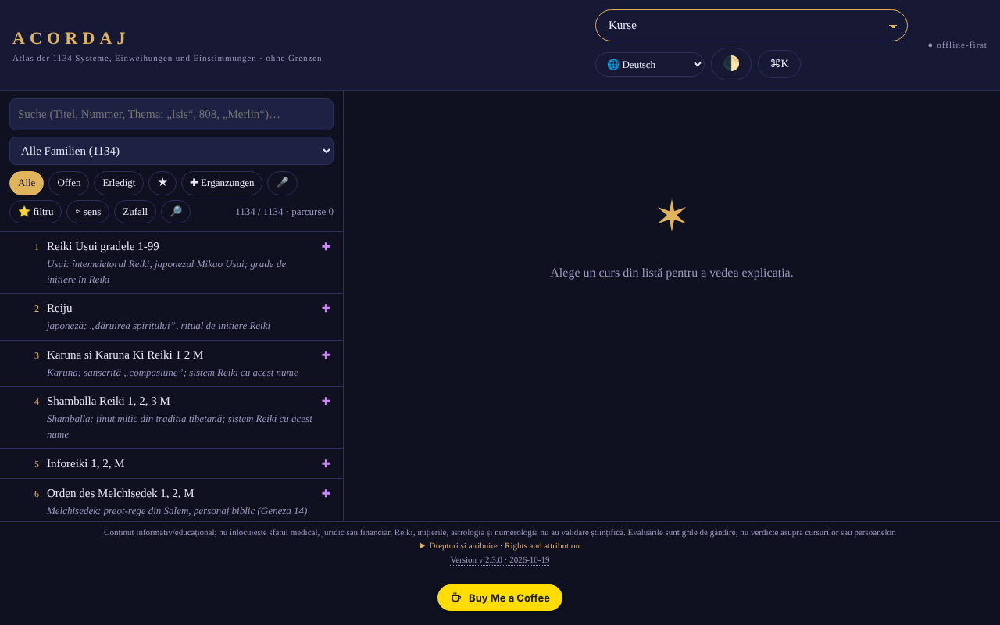

# ACORDAJ

[English](README.md) · [Română](README.ro.md) · [Français](README.fr.md) · [Italiano](README.it.md) · [Español](README.es.md) · [Português](README.pt.md) · **Deutsch** · [Magyar](README.hu.md)

**Version:** 2.3.8 · **Zuletzt aktualisiert:** 2026-10-22

Oberflächensprachen: **Română, English, Français, Italiano, Español, Português (PT), Deutsch, Magyar**

**Online-Anwendung / Demo:** https://chiuta.github.io/ACORDAJ/

ACORDAJ: Offline-Atlas in einer einzigen HTML-Datei mit 1134 spirituellen Kursen (Einstimmungen, Einweihungen, Reiki-Varianten …). Quellen, Bewertungen und Werkzeuge der Unterscheidung, in 8 Sprachen. Ohne Server, ohne Tracking, trade-free.

Offline-Atlas der 1134 spirituellen Kurse (Einstimmungen, Einweihungen, Reiki-Varianten und andere), gruppiert in 28 Familien. Eine einzige HTML-Datei: Sie öffnen sie mit einem Doppelklick, ohne Installation, ohne Konto, ohne Internet.

> **Hinweis:** informativer/bildender Inhalt; er ersetzt keine medizinische, rechtliche oder finanzielle Beratung. Reiki, Einweihungen, Astrologie und Numerologie haben keine wissenschaftliche Validierung; die Anwendung behandelt diese Themen kritisch, als kulturelle und historische Themen.

## Datenquelle
Die Liste der 1134 Titel (Systeme, Einweihungen, Einstimmungen) stammt von cursurispirituale.webnode.ro und ist in der dortigen Reihenfolge und Nummerierung erhalten; die Website listet nur Titel auf. Die Erklärungen in der Anwendung sind nach Familien und Themen verfasst und **beschreiben nicht den tatsächlichen Inhalt der Kurse**. Die Rechte an der ursprünglichen Liste wurden nicht geprüft.

## Was enthalten ist
- Ein Datenblatt für jeden Kurs: woher er kommt, was versprochen wird, was sich überprüfen lässt
- Bewertungen auf Familienebene (28 Familien, je 3–5 neutrale Quellen: Enzyklopädien, NCCIH, Stanford usw.), im Atlas verfasst und unabhängig von den Websites der Anbieter; es sind keine Bewertungen jedes einzelnen Kurses, und nicht alle einzelnen Datenblätter haben eigene Quellen
- Werkstatt: Studienwerkzeuge, kritische Unterscheidung, Gestaltung und Offline-Gemeinschaft
- SWOT- und TOWS-Analysen für jeden Kurs und jede Kategorie
- Oberfläche in 8 Sprachen: RO, EN, FR, ES, DE, IT, PT, HU
- Funktioniert auf Telefon, Tablet und Desktop (iOS, Android)

## Prinzipien
- Ohne Grenzen: eine Datei, ohne Server, ohne Konto
- Trade-free: ohne Werbung, ohne Tracking, nichts wird verkauft
- Sie bewertet, sie empfiehlt nicht

## Grenzen
- Die Bewertungen sind Denkraster, keine Urteile über Kurse oder Personen.
- Die Oberfläche **und der Inhalt** (Kursdatenblätter, Atlaslegenden, Zeitleisten, Coach-/Geschichtstexte, Glossar: fast 477.000 Zeichen) liegen in den 8 Sprachen vor; unverändert bleiben nur Eigennamen und Kurstitel der Quelle, Notenbeispiele und der zweisprachige ro+en-Rechteblock. Die Inhaltsübersetzungen sind automatisch und nicht von Muttersprachlern geprüft, und die Passagen zu Gesundheit, Sicherheit und Geld (Einstimmungen, Kristalle, Feuer/Kundalini, psychische Chirurgie, „Fülle“ usw.) **müssen fachlich geprüft werden**; die App gibt keine medizinischen oder finanziellen Ratschläge.
- Die Hauptphasen des Mondes (Neu-/Vollmond) werden mit den Formeln von Meeus (Hauptterme) berechnet, mit einer Genauigkeit in der Größenordnung von Minuten (geprüft am Neumond vom 10.10.2026, 15:50 UTC, und am Vollmond vom 26.10.2026, 04:12 UTC); die Beleuchtung des Mondes wird aus der tatsächlichen Elongation Sonne–Mond berechnet (dieselben Formeln von Meeus, Hauptterme; Abweichung in der Größenordnung von ~1 %), und das Mondalter ist die tatsächliche Anzahl der Tage seit dem letzten Neumond.
- Es ist keine medizinische, rechtliche oder finanzielle Beratung.

## Verwendung
Laden Sie `index.html` aus den Releases herunter und öffnen Sie sie in einem Browser.
Integrität prüfen: `sha256sum index.html`

## Daten und Datenschutz
Durch Audit geprüft: Die Seite hat eine strenge CSP (`connect-src 'none'`) und stellt keine Netzwerkanfragen; Einstellungen und Notizen werden in `localStorage` gespeichert. Das Skript ist durch eine CSP mit Hash geschützt (`script-src 'sha256-…'`, ohne `'unsafe-inline'` für Skripte); Inline-Handler gibt es nicht mehr. Es gibt einen nur vom Benutzer ausgelösten Konnektivitätstest (die Schaltfläche im Abschnitt „Ohne Grenzen“), der von der CSP blockiert werden sollte.

## Rechte und Zuschreibung
- **Quelle der Liste:** Die 1134 Titel stammen von [cursurispirituale.webnode.ro](https://cursurispirituale.webnode.ro/) und sind in der dortigen Reihenfolge und Nummerierung erhalten. Die Titel gehören der Quelle und ihren Rechteinhabern; die Rechte an der ursprünglichen Liste wurden nicht geprüft.
- **Unabhängiges Projekt:** ACORDAJ ist nicht mit der Quellwebsite verbunden und wird von ihr weder gebilligt noch unterstützt.
- **Anteil des Autors:** der Code und die Struktur der Anwendung, unter der MIT-Lizenz (siehe `LICENSE`). Die erklärte Lizenz gilt NUR für diesen Teil. Die MIT-Lizenz deckt die Titel und Materialien Dritter **nicht** ab; die Rechte daran liegen bei den jeweiligen Inhabern.
- **Berichtigung / Entfernung:** Wenn Sie Rechteinhaber oder eine erwähnte Person sind und eine Berichtigung oder Entfernung wünschen, schreiben Sie an alexio@trom.tf; wir antworten innerhalb von 7 Tagen.

*Rechte und Zuschreibung (EN).* Die 1134 Kurstitel stammen von [cursurispirituale.webnode.ro](https://cursurispirituale.webnode.ro/) und sind in der Reihenfolge und Nummerierung jener Website erhalten; sie gehören der Quelle und ihren Rechteinhabern. ACORDAJ ist ein unabhängiges Projekt, nicht mit jener Website verbunden und nicht von ihr gebilligt. Der Anteil des Autors (Code und Struktur) steht unter der MIT-Lizenz; die MIT-Lizenz deckt die Titel und anderes Material Dritter nicht ab. Rechteinhaber oder erwähnte Personen, die eine Berichtigung oder Entfernung wünschen: Schreiben Sie an alexio@trom.tf; wir antworten innerhalb von 7 Tagen.

## Lizenz
MIT-Lizenz für den Code und die Struktur der Anwendung — siehe `LICENSE`. Die Titel der 1134 Kurse stammen von cursurispirituale.webnode.ro und sind nicht Teil dieser Lizenz (die Rechte an der Liste wurden nicht geprüft). Die Texte der Seite wurden im Audit der Runde 2 an die MIT-Lizenz angeglichen (zuvor erwähnten sie „ohne kommerziellen Zweck“).

## Neue Funktionen (v2.2.0)

- **Themensuche im gesamten Atlas** (die Schaltfläche 🔎 neben „Zufällig“, FFF.search): durchsucht Titel, Familien, Art der Praxis, Besonderheiten und die Themennotizen der 1134 Kurse, tolerant gegenüber Diakritika, kleinen Fehlern und Wortformen, mit geordneten Ergebnissen und direktem Sprung zum Datenblatt. Lokal, ohne KI und ohne Netzwerk. Sie durchsucht nicht die allgemeinen Erklärungen der Familie und beschreibt nicht den tatsächlichen Inhalt der Kurse (die Quellwebsite listet nur Titel). Die bestehende Suche in der Liste bleibt unverändert.
- **Transparenzetikett und .fff.json-Kopie** (gemeinsames Kit: core, label, bundle, search): Klick auf `v 2.2.0 · 2026-10-14` in der Fußzeile; es zeigt das Netzwerk (0 Anfragen), die gespeicherten Schlüssel und erlaubt den Export/Import (optional mit Passwort verschlüsselt) von Fortschritt und Favoriten aus `localStorage`. Die eigenen Sicherungsmechanismen unter „Daten“ bleiben bestehen.
- Die eingebettete SHA-256-Summe (die Integritätsprüfung in der Werkstatt) wurde neu berechnet; der neue Code liegt in einem separaten Skript, die CSP-Hashes wurden neu berechnet. `BUILD` = 2.2.0 / 2026-10-14.
- Die neuen Texte liegen auf ro, en, fr, it, es, pt, hu, de vor; die Übersetzungen fr/it/es/pt/hu/de sind automatisch und nicht von Muttersprachlern geprüft.
- Tests: `tests/fff-r8.test.mjs` (Netzwerk gesperrt, 1280 und 360 px, axe 0 Verstöße bei geöffnetem Dialog, Integrität, Favoriten in der Kopie).

## Verlauf / Changelog

- 2.3.8 — 2026-10-22: fff-kit 1.1.2: PBKDF2 mit 600.000 Iterationen, Schutz vor Clickjacking
- **2.3.7 (22. Oktober 2026):** Die semantische Suche (≈ Bedeutung) bricht bei Wörtern wie „constructor“ nicht mehr ab; ein einziges H1 pro Seite; echter Service Worker samt Manifest (funktioniert offline und lässt sich über https installieren); alert/confirm/prompt des Browsers durch eigene, in die 8 Sprachen übersetzte Dialoge ersetzt; CSV-Exporte stellen formelähnlichen Zellen ein Apostroph voran; Text mindestens 12 px; Meta-Description.
- **2.3.6 (22. Oktober 2026):** Das Kursblatt bleibt in anderen Sprachen nicht mehr rumänisch: Schaltflächen (Lesen/Vergleichen/Speichern), „Zum Thema“, „Grafische Darstellung“, Tooltips und der gesamte Oberflächentext des Blatts sind in allen 8 Sprachen übersetzt. Kurstitel und Kursinhalte bleiben in der Originalsprache.
- **2.3.5 (22. Oktober 2026):** Die letzten rumänischen Reste in den anderen Sprachen übersetzt: fünf Glossar-Begriffstitel, die „Quelle“-Links, die Leermeldung der Kursansicht, zwei aria-labels; der Seitentitel folgt jetzt der Oberflächensprache.

- **2.3.4 (19. Oktober 2026):** Der Inhalt (Kursdatenblätter, Atlaslegenden und SVG-Beschriftungen, Zeitleisten, Coach-/Geschichts-/Ergänzungstexte, Glossar, Rechtehinweis) ist nun in en, fr, es, de, it, pt, hu übersetzt (100 % des erfassten Textes); der Atlas wird beim Sprachwechsel neu gezeichnet. Automatische Übersetzungen, nicht von Muttersprachlern geprüft; die Passagen zu Gesundheit/Sicherheit/Geld müssen fachlich geprüft werden.

- **2.2.0 (14. Oktober 2026):** Themensuche (FFF.search), Transparenzetikett und .fff.json-Kopie (gemeinsames Kit), Tests; eingebettete SHA-256-Summe neu berechnet.

- **2.1.4 (12. Oktober 2026):** Version und Datum der letzten Aktualisierung werden in der Anwendung angezeigt (Fußzeile); die eingebettete SHA-256-Summe und der CSP-Hash wurden neu berechnet.

- **2.1.3 (11. Oktober 2026, Rev. 3):** Beleuchtung des Mondes aus der tatsächlichen Elongation (Meeus, Hauptterme) statt Interpolation zwischen den Phasen (geprüft: ≈0,1 % beim Neumond vom 10.10.2026, ≈99,8 % beim Vollmond vom 26.10.2026, ≈50 % beim ersten Viertel vom 15.04.2024); Mondalter = tatsächliche Tage seit dem letzten Neumond; Text im Zykluskalender (der noch von „mittlerer synodischer Berechnung“ sprach) korrigiert; Integritätssumme und CSP-Hash neu berechnet.
- **2.1.2 (11. Oktober 2026, Rev. 2):** CSP mit Hash für das Skript, ohne `'unsafe-inline'` (der letzte Inline-Handler, das Feld für den Teilen-Code, wurde ersetzt); Schaltfläche „Code kopieren“ beim Teilen von Listen; Mondphasen (Neu-/Vollmond) mit den Formeln von Meeus statt des mittleren Zyklus (Fehler bis zu ~20 h); das Anfangsdesign folgt der Systemvorgabe (hell/dunkel), wenn Sie keines gewählt haben, dazu Unterstützung für `prefers-contrast` und erzwungene Farben; Kontrast im hellen Design korrigiert; korrekte Überschriftenhierarchie unter „Kategorien“; scrollbare Tabellen lassen sich mit der Tastatur durchlaufen. Das Hauptmenü bleibt unter 1500 px ein Select (17 Einträge passen nicht in eine Zeile); das Select ist per Tastatur bedienbar.
- **2.1.1 (11. Oktober 2026):** Die Dialoge (Willkommensfenster usw.) haben einen zugänglichen Namen (`aria-label` aus dem Titel), daher axe-core: 0 Verstöße bei 1280 und 360 px; der Titel ACORDAJ ist jetzt `<h1>` (die Seite hat immer eine Überschrift der Ebene 1).
- Hauptmenü: Auf Bildschirmen ab 1500 px werden die Schaltflächen angezeigt (nicht nur das Select), für den direkten Zugriff per Tastatur/Automatisierung; unter 1500 px bleibt das Select.
- Der Hinweis „Erster Besuch?“ erscheint nicht mehr über dem Willkommensfenster und verdeckt auf dem Telefon nicht mehr die Liste (er erscheint erst nach dem Schließen des Willkommens, 3,5 s). `screenshot.png` erneuert.
- Die eingebettete SHA-256-Summe wurde nach den Änderungen neu berechnet (die Integritätsprüfung in der Werkstatt besteht). Version und Datum in `BUILD`: 2.1.1 / 2026-10-11. Die Datei ist ~2,1 MB groß; ungelöst: die Größe und die Rechte an der Quellliste (Entscheidung des Autors).

Audit: 2026-10-10; Runden 2 und 3: 2026-10-11
