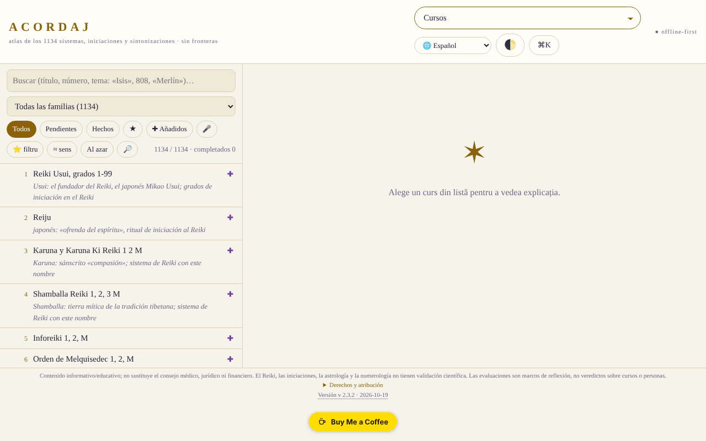

# ACORDAJ

[English](README.md) · [Română](README.ro.md) · [Français](README.fr.md) · [Italiano](README.it.md) · **Español** · [Português](README.pt.md) · [Deutsch](README.de.md) · [Magyar](README.hu.md)

**Versión:** 2.3.9 · **Última actualización:** 2026-10-22

Idiomas de la interfaz: **Română, English, Français, Italiano, Español, Português (PT), Deutsch, Magyar**

**Aplicación en línea / demo:** https://chiuta.github.io/ACORDAJ/

ACORDAJ: atlas sin conexión, en un único archivo HTML, de 1134 cursos espirituales (afinaciones, iniciaciones, variantes de Reiki…). Fuentes, evaluaciones y herramientas de discernimiento, en 8 idiomas. Sin servidor, sin rastreo, trade-free.

Atlas sin conexión de los 1134 cursos espirituales (afinaciones, iniciaciones, variantes de Reiki y otros), agrupados en 28 familias. Un único archivo HTML: se abre con doble clic, sin instalación, sin cuenta, sin internet.

> **Nota:** contenido informativo/educativo; no sustituye el consejo médico, jurídico ni financiero. El Reiki, las iniciaciones, la astrología y la numerología carecen de validación científica; la aplicación trata estos temas de forma crítica, como temas culturales e históricos.

## Fuente de los datos
La lista de los 1134 títulos (sistemas, iniciaciones, afinaciones) procede de cursurispirituale.webnode.ro, conservada en el orden y la numeración de ese sitio; el sitio solo enumera títulos. Las explicaciones de la aplicación están escritas por familias y temas y **no describen el contenido real de los cursos**. No se han verificado los derechos sobre la lista original.

## Qué contiene
- Una ficha para cada curso: de dónde viene, qué se promete, qué se puede verificar
- Evaluaciones a nivel de familia (28 familias, de 3 a 5 fuentes neutrales cada una: enciclopedias, NCCIH, Stanford, etc.), redactadas en el atlas e independientes de los sitios de los vendedores; no son evaluaciones de cada curso por separado, y no todas las fichas individuales tienen fuentes propias
- Taller: herramientas de estudio, discernimiento crítico, creación y comunidad sin conexión
- Análisis SWOT y TOWS para cada curso y cada categoría
- Interfaz en 8 idiomas: RO, EN, FR, ES, DE, IT, PT, HU
- Funciona en teléfono, tableta y escritorio (iOS, Android)

## Principios
- Sin fronteras: un archivo, sin servidor, sin cuenta
- Trade-free: sin anuncios, sin rastreo, no se vende nada
- Evalúa, no recomienda

## Límites
- Las evaluaciones son marcos de reflexión, no sentencias sobre cursos o personas.
- La interfaz **y el contenido** (fichas de los cursos, leyendas del atlas, cronologías, textos de coach/historia, glosario: casi 477 000 caracteres) están disponibles en los 8 idiomas; solo permanecen sin cambios los nombres propios y los títulos de los cursos de la fuente, las notas musicales y el bloque bilingüe ro+en sobre derechos. Las traducciones del contenido son automáticas, no verificadas por hablantes nativos, y los pasajes sobre salud, seguridad y dinero (sintonizaciones, cristales, fuego/kundalini, cirugía psíquica, «abundancia», etc.) **requieren revisión especializada**; la aplicación no ofrece consejos médicos ni financieros.
- Las fases principales de la Luna (nueva/llena) se calculan con las fórmulas de Meeus (términos principales), con una precisión del orden de minutos (verificadas con la luna nueva del 10.10.2026 a las 15:50 UTC y la luna llena del 26.10.2026 a las 04:12 UTC); la iluminación de la Luna se calcula a partir de la elongación real Sol–Luna (las mismas fórmulas de Meeus, términos principales; desviación del orden de ~1 %), y la edad de la Luna es el número real de días desde la última luna nueva.
- No es consejo médico, jurídico ni financiero.

## Uso
Descarga `index.html` desde Releases y ábrelo en un navegador.
Comprueba la integridad: `sha256sum index.html`

## Datos y privacidad
Verificado mediante auditoría: la página tiene una CSP estricta (`connect-src 'none'`) y no realiza solicitudes de red; las preferencias y las notas se guardan en `localStorage`. El script está protegido por una CSP con hash (`script-src 'sha256-…'`, sin `'unsafe-inline'` para los scripts); ya no quedan manejadores en línea. Existe una prueba de conectividad activada solo por el usuario (el botón de la sección «Sin fronteras»), que debería ser bloqueada por la CSP.

## Derechos y atribución
- **Fuente de la lista:** los 1134 títulos proceden de [cursurispirituale.webnode.ro](https://cursurispirituale.webnode.ro/), conservados en el orden y la numeración de ese sitio. Los títulos pertenecen a la fuente y a sus titulares; no se han verificado los derechos sobre la lista original.
- **Proyecto independiente:** ACORDAJ no está afiliado al sitio de origen y no está aprobado ni respaldado por este.
- **Parte del autor:** el código y la estructura de la aplicación, bajo licencia MIT (véase `LICENSE`). La licencia declarada se aplica SOLO a esta parte. La licencia MIT **no** cubre los títulos ni los materiales de terceros; los derechos sobre estos pertenecen a sus titulares.
- **Rectificación / retirada:** si eres titular de derechos o una persona mencionada y deseas la corrección o la retirada, escribe a alexio@trom.tf; respondemos en 7 días.

*Derechos y atribución (EN).* Los 1134 títulos de cursos proceden de [cursurispirituale.webnode.ro](https://cursurispirituale.webnode.ro/), conservados en el orden y la numeración de ese sitio; pertenecen a la fuente y a sus titulares de derechos. ACORDAJ es un proyecto independiente, no afiliado a ese sitio ni respaldado por él. La parte del autor (código y estructura) está bajo licencia MIT; la licencia MIT no cubre los títulos ni otros materiales de terceros. Los titulares de derechos o personas mencionadas que deseen corrección o retirada: escribid a alexio@trom.tf; respondemos en 7 días.

## Licencia
Licencia MIT para el código y la estructura de la aplicación — véase `LICENSE`. Los títulos de los 1134 cursos proceden de cursurispirituale.webnode.ro y no forman parte de esta licencia (no se han verificado los derechos sobre la lista). Los textos de la página se alinearon con la licencia MIT en la auditoría de la ronda 2 (antes mencionaban «sin fines comerciales»).

## Funciones nuevas (v2.2.0)

- **Búsqueda por tema en todo el atlas** (el botón 🔎 junto a «Aleatorio», FFF.search): busca en el título, las familias, el tipo de práctica, las particularidades y las notas temáticas de los 1134 cursos, tolerante con diacríticos, pequeños errores y formas de las palabras, con resultados ordenados y salto directo a la ficha. En local, sin IA y sin red. No busca en las explicaciones generales de la familia y no describe el contenido real de los cursos (el sitio de origen solo enumera títulos). La búsqueda existente en la lista permanece sin cambios.
- **Etiqueta de transparencia y copia .fff.json** (kit común: core, label, bundle, search): haz clic en `v 2.2.0 · 2026-10-14` en el pie de página; muestra la red (0 solicitudes), las claves almacenadas y permite exportar/importar (opcionalmente cifrado con contraseña) el progreso y los favoritos de `localStorage`. Los mecanismos de copia propios de «Datos» se mantienen.
- La suma SHA-256 incorporada (la comprobación de integridad del Taller) se recalculó; el código nuevo está en un script aparte y los hashes CSP se recalcularon. `BUILD` = 2.2.0 / 2026-10-14.
- Los textos nuevos están en ro, en, fr, it, es, pt, hu, de; las traducciones fr/it/es/pt/hu/de son automáticas y no están verificadas por hablantes nativos.
- Pruebas: `tests/fff-r8.test.mjs` (red bloqueada, 1280 y 360 px, axe 0 infracciones con el diálogo abierto, integridad, favoritos en la copia).

## Historial / Changelog

- 2.3.9 — 2026-10-22: fff-kit 1.1.4: objetivos táctiles y tamaño mínimo de texto
- 2.3.8 — 2026-10-22: fff-kit 1.1.2: PBKDF2 600 000 iteraciones, protección anti-clickjacking
- **2.3.7 (22 de octubre de 2026):** La búsqueda semántica (≈ significado) ya no falla con palabras como «constructor»; un solo H1 por página; service worker y manifiesto reales (funciona sin conexión y se puede instalar por https); alert/confirm/prompt del navegador sustituidos por diálogos propios traducidos a los 8 idiomas; las exportaciones CSV anteponen un apóstrofo a las celdas que parecen fórmulas; texto mínimo de 12 px; meta description.
- **2.3.6 (22 de octubre de 2026):** La ficha de un curso ya no queda en rumano en los demás idiomas: botones (Leer/Comparar/Guardar), «Sobre el tema», «Representación gráfica», tooltips y todo el texto de interfaz de la ficha se traducen a los 8 idiomas. Los títulos y el contenido de los cursos siguen en el idioma original.
- **2.3.5 (22 de octubre de 2026):** Traducidos los últimos elementos que seguían en rumano en los demás idiomas: cinco títulos de términos del glosario, los enlaces «fuente», el mensaje vacío de la vista de cursos, dos aria-label; el título de la página ahora sigue el idioma de la interfaz.

- **2.3.4 (19 de octubre de 2026):** el contenido (fichas de los cursos, leyendas y etiquetas SVG del atlas, cronologías, textos de coach/historia/adiciones, glosario, nota de derechos) está traducido a en, fr, es, de, it, pt, hu (100 % del texto identificado); el atlas se redibuja al cambiar de idioma. Traducciones automáticas, no verificadas por hablantes nativos; los pasajes sobre salud/seguridad/dinero requieren revisión especializada.

- **2.2.0 (14 de octubre de 2026):** búsqueda por tema (FFF.search), etiqueta de transparencia y copia .fff.json (kit común), pruebas; suma SHA-256 incorporada recalculada.

- **2.1.4 (12 de octubre de 2026):** la versión y la fecha de la última actualización se muestran en la aplicación (pie de página); la suma SHA-256 incorporada y el hash CSP se recalcularon.

- **2.1.3 (11 de octubre de 2026, rev. 3):** iluminación de la Luna a partir de la elongación real (Meeus, términos principales) en lugar de la interpolación entre fases (verificado: ≈0,1 % en la luna nueva del 10.10.2026, ≈99,8 % en la luna llena del 26.10.2026, ≈50 % en el cuarto creciente del 15.04.2024); edad de la Luna = días reales desde la última luna nueva; texto del Calendario de ciclos (que aún hablaba de «cálculo medio-sinódico») corregido; suma de integridad y hash CSP recalculados.
- **2.1.2 (11 de octubre de 2026, rev. 2):** CSP con hash para el script, sin `'unsafe-inline'` (se sustituyó el último manejador en línea, el campo del código de compartir); botón «Copiar el código» al compartir listas; fases de la Luna (nueva/llena) con las fórmulas de Meeus, en lugar del ciclo medio (error de hasta ~20 h); el tema inicial sigue la preferencia del sistema (claro/oscuro) cuando no has elegido ninguno, además de compatibilidad con `prefers-contrast` y colores forzados; contraste corregido en el tema claro; jerarquía de títulos correcta en «Categorías»; las tablas desplazables se pueden recorrer con el teclado. El menú principal sigue siendo un select por debajo de 1500 px (17 entradas no caben en una fila); el select es accesible con el teclado.
- **2.1.1 (11 de octubre de 2026):** los diálogos (ventana de bienvenida, etc.) tienen nombre accesible (`aria-label` tomado del título), por lo que axe-core: 0 infracciones a 1280 y 360 px; el título ACORDAJ es ahora `<h1>` (la página siempre tiene un encabezado de nivel 1).
- Menú principal: en pantallas de al menos 1500 px se muestran los botones (no solo el select), para acceso directo por teclado/automatización; por debajo de 1500 px permanece el select.
- La indicación «¿Primera visita?» ya no aparece sobre la ventana de bienvenida ni cubre la lista en el teléfono (aparece solo después de cerrar la bienvenida, 3,5 s). `screenshot.png` renovado.
- La suma SHA-256 incorporada se recalculó tras los cambios (la comprobación de integridad del Taller se supera). Versión y fecha en `BUILD`: 2.1.1 / 2026-10-11. El archivo pesa ~2,1 MB; sin resolver: el tamaño y los derechos sobre la lista de origen (decisión del autor).

Auditoría: 2026-10-10; rondas 2 y 3: 2026-10-11
