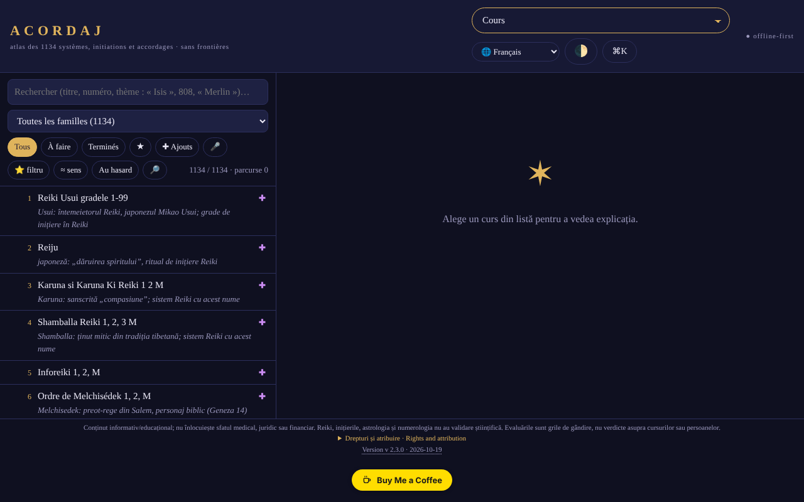

# ACORDAJ

[English](README.md) · [Română](README.ro.md) · **Français** · [Italiano](README.it.md) · [Español](README.es.md) · [Português](README.pt.md) · [Deutsch](README.de.md) · [Magyar](README.hu.md)

**Version :** 2.3.4 · **Dernière mise à jour :** 2026-10-19

Langues de l'interface : **Română, English, Français, Italiano, Español, Português (PT), Deutsch, Magyar**

**Application en ligne / démo :** https://chiuta.github.io/ACORDAJ/

ACORDAJ : atlas hors ligne, dans un seul fichier HTML, de 1134 cours spirituels (accordages, initiations, variantes de Reiki…). Sources, évaluations et outils de discernement, en 8 langues. Sans serveur, sans pistage, trade-free.

Atlas hors ligne des 1134 cours spirituels (accordages, initiations, variantes de Reiki et autres), regroupés en 28 familles. Un seul fichier HTML : on l'ouvre d'un double clic, sans installation, sans compte, sans internet.

> **Remarque :** contenu informatif/éducatif ; il ne remplace pas un avis médical, juridique ou financier. Le Reiki, les initiations, l'astrologie et la numérologie n'ont pas de validation scientifique ; l'application traite ces sujets de façon critique, comme des thèmes culturels et historiques.

## Source des données
La liste des 1134 titres (systèmes, initiations, accordages) provient de cursurispirituale.webnode.ro, conservée dans l'ordre et la numérotation de ce site ; le site ne liste que des titres. Les explications de l'application sont rédigées par familles et par thèmes et **ne décrivent pas le contenu réel des cours**. Les droits sur la liste d'origine n'ont pas été vérifiés.

## Contenu
- Une fiche pour chaque cours : d'où il vient, ce qui est promis, ce qui peut être vérifié
- Évaluations au niveau des familles (28 familles, 3 à 5 sources neutres chacune : encyclopédies, NCCIH, Stanford, etc.), rédigées dans l'atlas et indépendantes des sites des vendeurs ; ce ne sont pas des évaluations de chaque cours pris isolément, et toutes les fiches individuelles n'ont pas leurs propres sources
- Atelier : outils d'étude, discernement critique, création et communauté hors ligne
- Analyses SWOT et TOWS pour chaque cours et chaque catégorie
- Interface en 8 langues : RO, EN, FR, ES, DE, IT, PT, HU
- Fonctionne sur téléphone, tablette et ordinateur (iOS, Android)

## Principes
- Sans frontières : un fichier, sans serveur, sans compte
- Trade-free : sans publicité, sans pistage, rien n'est vendu
- Il évalue, il ne recommande pas

## Limites
- Les évaluations sont des grilles de réflexion, non des verdicts sur des cours ou des personnes.
- Les traductions couvrent l'interface, pas les fiches des cours (qui restent en roumain).
- Les phases principales de la Lune (nouvelle/pleine) sont calculées avec les formules de Meeus (termes principaux), avec une précision de l'ordre de la minute (vérifiées sur la nouvelle lune du 10.10.2026 à 15:50 UTC et la pleine lune du 26.10.2026 à 04:12 UTC) ; l'illumination de la Lune est calculée à partir de l'élongation réelle Soleil–Lune (mêmes formules de Meeus, termes principaux ; écart de l'ordre de ~1 %), et l'âge de la Lune est le nombre réel de jours depuis la dernière nouvelle lune.
- Ce n'est pas un avis médical, juridique ou financier.

## Utilisation
Téléchargez `index.html` depuis les Releases et ouvrez-le dans un navigateur.
Vérifiez l'intégrité : `sha256sum index.html`

## Données et confidentialité
Vérifié par audit : la page a une CSP stricte (`connect-src 'none'`) et ne fait aucune requête réseau ; les préférences et les notes sont conservées dans `localStorage`. Le script est protégé par une CSP avec hash (`script-src 'sha256-…'`, sans `'unsafe-inline'` pour les scripts) ; il n'existe plus de gestionnaires en ligne. Il existe un test de connectivité déclenché uniquement par l'utilisateur (le bouton de la section « Sans frontières »), qui devrait être bloqué par la CSP.

## Droits et attribution
- **Source de la liste :** les 1134 titres proviennent de [cursurispirituale.webnode.ro](https://cursurispirituale.webnode.ro/), conservés dans l'ordre et la numérotation de ce site. Les titres appartiennent à la source et à leurs titulaires ; les droits sur la liste d'origine n'ont pas été vérifiés.
- **Projet indépendant :** ACORDAJ n'est pas affilié au site source et n'est ni approuvé ni soutenu par celui-ci.
- **Part de l'auteur :** le code et la structure de l'application, sous licence MIT (voir `LICENSE`). La licence déclarée ne s'applique QU'À cette part. La licence MIT **ne** couvre **pas** les titres et les contenus de tiers ; les droits sur ceux-ci appartiennent à leurs titulaires.
- **Rectification / retrait :** si vous êtes titulaire de droits ou une personne mentionnée et souhaitez une correction ou un retrait, écrivez à alexio@trom.tf ; nous répondons sous 7 jours.

*Droits et attribution (EN).* Les 1134 titres de cours proviennent de [cursurispirituale.webnode.ro](https://cursurispirituale.webnode.ro/), conservés dans l'ordre et la numérotation de ce site ; ils appartiennent à la source et à leurs titulaires de droits. ACORDAJ est un projet indépendant, non affilié à ce site ni approuvé par lui. La part de l'auteur (code et structure) est sous licence MIT ; la licence MIT ne couvre pas les titres ni les autres contenus de tiers. Les titulaires de droits ou personnes mentionnées souhaitant une correction ou un retrait : écrivez à alexio@trom.tf ; nous répondons sous 7 jours.

## Licence
Licence MIT pour le code et la structure de l'application — voir `LICENSE`. Les titres des 1134 cours proviennent de cursurispirituale.webnode.ro et ne font pas partie de cette licence (les droits sur la liste n'ont pas été vérifiés). Les textes de la page ont été alignés sur la licence MIT lors de l'audit du tour 2 (ils mentionnaient auparavant « sans but commercial »).

## Nouvelles fonctions (v2.2.0)

- **Recherche par thème dans tout l'atlas** (le bouton 🔎 à côté de « Aléatoire », FFF.search) : recherche dans le titre, les familles, le type de pratique, les particularités et les notes thématiques des 1134 cours, tolérante aux diacritiques, aux petites fautes et aux formes des mots, avec des résultats classés et un saut direct vers la fiche. En local, sans IA et sans réseau. Elle ne recherche pas dans les explications générales de la famille et ne décrit pas le contenu réel des cours (le site source ne liste que des titres). La recherche existante dans la liste reste inchangée.
- **Étiquette de transparence et copie .fff.json** (kit commun : core, label, bundle, search) : cliquez sur `v 2.2.0 · 2026-10-14` dans le pied de page ; elle affiche le réseau (0 requête), les clés stockées et permet l'export/import (éventuellement chiffré par mot de passe) de la progression et des favoris depuis `localStorage`. Les mécanismes de copie propres de « Données » demeurent.
- La somme SHA-256 intégrée (la vérification d'intégrité de l'Atelier) a été recalculée ; le nouveau code se trouve dans un script séparé, les hash CSP ont été recalculés. `BUILD` = 2.2.0 / 2026-10-14.
- Les nouveaux textes sont en ro, en, fr, it, es, pt, hu, de ; les traductions fr/it/es/pt/hu/de sont automatiques et non vérifiées par des locuteurs natifs.
- Tests : `tests/fff-r8.test.mjs` (réseau bloqué, 1280 et 360 px, axe 0 violation avec la boîte de dialogue ouverte, intégrité, favoris dans la copie).

## Historique / Changelog

- **2.2.0 (14 octobre 2026) :** recherche par thème (FFF.search), étiquette de transparence et copie .fff.json (kit commun), tests ; somme SHA-256 intégrée recalculée.

- **2.1.4 (12 octobre 2026) :** la version et la date de dernière mise à jour sont affichées dans l'application (pied de page) ; la somme SHA-256 intégrée et le hash CSP ont été recalculés.

- **2.1.3 (11 octobre 2026, rév. 3) :** illumination de la Lune à partir de l'élongation réelle (Meeus, termes principaux) au lieu d'une interpolation entre les phases (vérifié : ≈0,1 % à la nouvelle lune du 10.10.2026, ≈99,8 % à la pleine lune du 26.10.2026, ≈50 % au premier quartier du 15.04.2024) ; âge de la Lune = jours réels depuis la dernière nouvelle lune ; texte du Calendrier des cycles (qui parlait encore de « calcul moyen-synodique ») corrigé ; somme d'intégrité et hash CSP recalculés.
- **2.1.2 (11 octobre 2026, rév. 2) :** CSP avec hash pour le script, sans `'unsafe-inline'` (le dernier gestionnaire en ligne, le champ du code de partage, a été remplacé) ; bouton « Copier le code » lors du partage des listes ; phases de la Lune (nouvelle/pleine) avec les formules de Meeus, au lieu du cycle moyen (erreur jusqu'à ~20 h) ; le thème initial suit la préférence du système (clair/sombre) lorsque vous n'en avez pas choisi, plus prise en charge de `prefers-contrast` et des couleurs forcées ; contraste corrigé dans le thème clair ; hiérarchie de titres correcte dans « Catégories » ; les tableaux défilants peuvent être parcourus au clavier. Le menu principal reste un select sous 1500 px (17 entrées ne tiennent pas sur une ligne) ; le select est accessible au clavier.
- **2.1.1 (11 octobre 2026) :** les boîtes de dialogue (fenêtre de bienvenue, etc.) ont un nom accessible (`aria-label` issu du titre), donc axe-core : 0 violation à 1280 et 360 px ; le titre ACORDAJ est désormais `<h1>` (la page a toujours un titre de niveau 1).
- Menu principal : sur les écrans d'au moins 1500 px, les boutons sont affichés (et pas seulement le select), pour un accès direct au clavier/par automatisation ; sous 1500 px, le select demeure.
- L'indication « Première visite ? » n'apparaît plus par-dessus la fenêtre de bienvenue et ne couvre plus la liste sur téléphone (elle n'apparaît qu'après la fermeture de la bienvenue, 3,5 s). `screenshot.png` renouvelé.
- La somme SHA-256 intégrée a été recalculée après les modifications (la vérification d'intégrité de l'Atelier réussit). Version et date dans `BUILD` : 2.1.1 / 2026-10-11. Le fichier fait ~2,1 Mo ; non résolu : la taille et les droits sur la liste source (décision de l'auteur).

Audit : 2026-10-10 ; tours 2 et 3 : 2026-10-11
