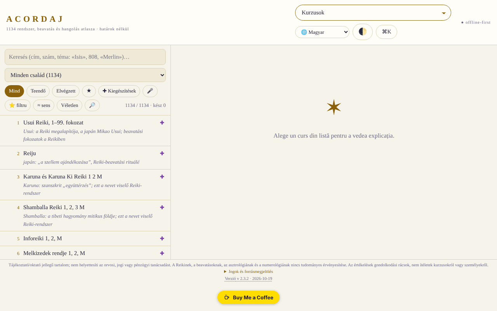

# ACORDAJ

[English](README.md) · [Română](README.ro.md) · [Français](README.fr.md) · [Italiano](README.it.md) · [Español](README.es.md) · [Português](README.pt.md) · [Deutsch](README.de.md) · **Magyar**

**Verzió:** 2.3.11 · **Utolsó frissítés:** 2026-10-23

A felület nyelvei: **Română, English, Français, Italiano, Español, Português (PT), Deutsch, Magyar**

**Online alkalmazás / demó:** https://chiuta.github.io/ACORDAJ/

ACORDAJ: offline atlasz egyetlen HTML-fájlban, 1134 spirituális kurzussal (hangolások, beavatások, Reiki-változatok…). Források, értékelések és megkülönböztető eszközök, 8 nyelven. Szerver nélkül, követés nélkül, trade-free.

Az 1134 spirituális kurzus (hangolások, beavatások, Reiki-változatok és mások) offline atlasza, 28 családba csoportosítva. Egyetlen HTML-fájl: dupla kattintással megnyitod, telepítés, fiók és internet nélkül.

> **Megjegyzés:** tájékoztató/oktatási tartalom; nem helyettesíti az orvosi, jogi vagy pénzügyi tanácsot. A Reikinek, a beavatásoknak, az asztrológiának és a numerológiának nincs tudományos igazolása; az alkalmazás ezeket a témákat kritikusan, kulturális és történeti témákként kezeli.

## Az adatok forrása
Az 1134 cím (rendszerek, beavatások, hangolások) listája a cursurispirituale.webnode.ro oldalról származik, az ottani sorrendben és számozással megőrizve; az oldal csak címeket sorol fel. Az alkalmazásban szereplő magyarázatok családok és témák szerint íródtak, és **nem írják le a kurzusok valódi tartalmát**. Az eredeti lista jogait nem ellenőriztük.

## Mit tartalmaz
- Minden kurzushoz egy adatlap: honnan származik, mit ígér, mi ellenőrizhető
- Családszintű értékelések (28 család, egyenként 3–5 semleges forrással: enciklopédiák, NCCIH, Stanford stb.), az atlaszban megírva és az eladók weboldalaitól függetlenül; nem az egyes kurzusok külön értékelései, és nem minden egyedi adatlapnak van saját forrása
- Műhely: tanulmányi eszközök, kritikai megkülönböztetés, alkotás és offline közösség
- SWOT- és TOWS-elemzések minden kurzushoz és minden kategóriához
- Felület 8 nyelven: RO, EN, FR, ES, DE, IT, PT, HU
- Működik telefonon, táblagépen és asztali gépen (iOS, Android)

## Alapelvek
- Határok nélkül: egy fájl, szerver nélkül, fiók nélkül
- Trade-free: reklám nélkül, követés nélkül, semmit nem árul
- Értékel, nem ajánl

## Korlátok
- Az értékelések gondolkodási rácsok, nem ítéletek kurzusokról vagy személyekről.
- A felület **és a tartalom** (kurzusadatlapok, az atlasz jelmagyarázatai, idővonalak, coach-/történetszövegek, szójegyzék: közel 477 000 karakter) mind a 8 nyelven elérhető; csak a forrás tulajdonnevei és kurzuscímei, a hangjegyek és a kétnyelvű ro+en jogi blokk maradnak változatlanul. A tartalom fordításai automatikusak, anyanyelvi beszélők nem ellenőrizték, az egészségről, biztonságról és pénzről szóló részek (hangolások, kristályok, tűz/kundalini, pszichikai műtét, „bőség” stb.) pedig **szakmai felülvizsgálatot igényelnek**; az alkalmazás nem ad orvosi vagy pénzügyi tanácsot.
- A Hold fő fázisait (újhold/telihold) Meeus képleteivel számoljuk (főtagok), percnagyságrendű pontossággal (ellenőrizve a 2026.10.10-i, 15:50 UTC-kor bekövetkező újholdon és a 2026.10.26-i, 04:12 UTC-kor bekövetkező teliholdon); a Hold megvilágítása a Nap–Hold valódi elongációjából számolódik (ugyanazok a Meeus-képletek, főtagok; ~1 % nagyságrendű eltérés), a Hold kora pedig az utolsó újhold óta eltelt valódi napok száma.
- Nem orvosi, jogi vagy pénzügyi tanács.

## Használat
Töltsd le az `index.html` fájlt a Releases oldalról, és nyisd meg egy böngészőben.
Az integritás ellenőrzése: `sha256sum index.html`

## Adatok és adatvédelem
Audittal ellenőrizve: az oldalon szigorú CSP van (`connect-src 'none'`), és nem végez hálózati kéréseket; a beállítások és a jegyzetek a `localStorage`-ben maradnak. A szkriptet hash-sel ellátott CSP védi (`script-src 'sha256-…'`, a szkriptekhez `'unsafe-inline'` nélkül); beágyazott eseménykezelők már nincsenek. Van egy csak a felhasználó által elindított kapcsolatteszt (a „Határok nélkül” szakasz gombja), amelyet a CSP-nek blokkolnia kell.

**Szándékos CSP-önteszt.** Az egyetlen hálózatnak tűnő kód az átláthatósági panel gombja, amely csak kattintásra próbál egy `fetch`-et a `https://example.com/` felé. Nem küld adatot; azt mutatja meg, hogy a CSP **blokkolja** a kapcsolatot. Szándékosan van deklarálva a `fff.config.json`-ban (`cspSelfTest`): az átláthatósági címke `example.com` bejegyzése ez a teszt, nem valódi függőség.

## Jogok és forrásmegjelölés
- **A lista forrása:** az 1134 cím a [cursurispirituale.webnode.ro](https://cursurispirituale.webnode.ro/) oldalról származik, az ottani sorrendben és számozással megőrizve. A címek a forrást és jogtulajdonosaikat illetik; az eredeti lista jogait nem ellenőriztük.
- **Független projekt:** az ACORDAJ nincs kapcsolatban a forrásoldallal, és az nem hagyta jóvá, nem támogatja.
- **A szerző része:** az alkalmazás kódja és szerkezete, MIT licenc alatt (lásd `LICENSE`). A megadott licenc CSAK erre a részre vonatkozik. Az MIT licenc **nem** fedi a címeket és a harmadik felek anyagait; ezek jogai a tulajdonosaikat illetik.
- **Helyesbítés / eltávolítás:** ha jogtulajdonos vagy megemlített személy vagy, és helyesbítést vagy eltávolítást kérsz, írj az alexio@trom.tf címre; 7 napon belül válaszolunk.

*Rights and attribution (EN) — Jogok és forrásmegjelölés (összefoglaló).* Az 1134 kurzuscím a [cursurispirituale.webnode.ro](https://cursurispirituale.webnode.ro/) oldalról származik, az ottani sorrendben és számozással megőrizve; a forrást és jogtulajdonosaikat illetik. Az ACORDAJ független projekt, nincs kapcsolatban azzal az oldallal, és az nem hagyta jóvá. A szerző része (kód és szerkezet) MIT licenc alatt áll; az MIT licenc nem fedi a címeket és más harmadik féltől származó anyagot. A jogtulajdonosok vagy megemlített személyek, akik helyesbítést vagy eltávolítást kérnek: írjanak az alexio@trom.tf címre; 7 napon belül válaszolunk.

## Licenc
MIT licenc az alkalmazás kódjára és szerkezetére — lásd `LICENSE`. Az 1134 kurzus címei a cursurispirituale.webnode.ro oldalról származnak, és nem tartoznak ehhez a licenchez (a lista jogait nem ellenőriztük). Az oldal szövegeit a 2. kör auditjában igazítottuk az MIT licenchez (korábban „nem kereskedelmi célra” szerepelt bennük).

## Új funkciók (v2.2.0)

- **Témakeresés az egész atlaszban** (a „Véletlen” melletti 🔎 gomb, FFF.search): keres az 1134 kurzus címében, családjaiban, a gyakorlat típusában, sajátosságaiban és témajegyzeteiben, tolerálja az ékezeteket, a kisebb elírásokat és a szóalakokat, rangsorolt találatokkal és közvetlen ugrással az adatlapra. Helyben, mesterséges intelligencia és hálózat nélkül. Nem keres a család általános magyarázataiban, és nem írja le a kurzusok valódi tartalmát (a forrásoldal csak címeket sorol fel). A listában meglévő keresés változatlan marad.
- **Átláthatósági címke és .fff.json másolat** (közös kit: core, label, bundle, search): kattints a `v 2.2.0 · 2026-10-14` feliratra a láblécben; megmutatja a hálózatot (0 kérés), a tárolt kulcsokat, és lehetővé teszi a haladás és a kedvencek exportálását/importálását a `localStorage`-ből (opcionálisan jelszóval titkosítva). Az „Adatok” alatti saját mentési mechanizmusok megmaradnak.
- A beágyazott SHA-256 összeg (a Műhely integritás-ellenőrzése) újraszámolva; az új kód külön szkriptben van, a CSP-hasheket újraszámoltuk. `BUILD` = 2.2.0 / 2026-10-14.
- Az új szövegek ro, en, fr, it, es, pt, hu, de nyelven vannak; az fr/it/es/pt/hu/de fordítások automatikusak, anyanyelvi beszélők nem ellenőrizték őket.
- Tesztek: `tests/fff-r8.test.mjs` (blokkolt hálózat, 1280 és 360 px, axe 0 szabálysértés megnyitott párbeszédablakkal, integritás, kedvencek a másolatban).

## Előzmények / Changelog
- **2.3.10 — 2026-10-22:** Méret: az oldal 8,2 MB-ról 1,9 MB-ra csökken. A felület szótára (6 270 sor × 8 nyelv, 6,3 MB) az `i18n/keys.js` fájlba és nyelvenként egy fájlba került, igény szerint töltődik (a román nem tölt semmit; más nyelv a keys + angol + a választott nyelvet tölti); a service worker gyorsítótárazza őket, tétlen oldalnál a többi a háttérben töltődik (script címkékkel; Save-Data / lassú kapcsolat esetén nem), így a nyelvváltás offline is működik; ha egy csomag nem érhető el, értesítés jelenik meg és a szöveg román marad. CSP: ezekhez a fájlokhoz `script-src 'self'` került be (a `connect-src` marad `'none'`). A beágyazott integritás-hash (EMBED_SHA) újraszámolva, a diagnosztika pedig már nem számítja külső kérésnek a csomagokat. Új teszt: `tests/lazy.test.mjs`.

- 2.3.9 — 2026-10-22: fff-kit 1.1.4: érintési célpontok és minimális szövegméret
- 2.3.8 — 2026-10-22: fff-kit 1.1.2: PBKDF2 600 000 iteráció, clickjacking elleni védelem
- **2.3.7 (2026. október 22.):** A szemantikus (≈ jelentés) keresés már nem omlik össze az olyan szavaknál, mint a „constructor”; oldalanként egyetlen H1; valódi service worker és manifest (offline is működik, https-en telepíthető); a böngésző alert/confirm/prompt ablakait saját, mind a 8 nyelvre lefordított párbeszédablakok váltják; a CSV-exportok képletnek látszó celláit aposztróf előzi meg; legalább 12 px-es szöveg; meta description.
- **2.3.6 (2026. október 22.):** A kurzus lapja a többi nyelven már nem marad románul: gombok (Olvasás/Összehasonlítás/Mentés), „A témáról”, „Grafikus ábrázolás”, buborékok és a lap minden felületi szövege mind a 8 nyelven le van fordítva. A kurzuscímek és a tartalom az eredeti nyelven marad.
- **2.3.5 (2026. október 22.):** Lefordítva a többi nyelvben maradt utolsó román elemek: öt szószedet-címszó, a „forrás” hivatkozások, a kurzusnézet üres állapotának üzenete, két aria-label; az oldal címe mostantól a felület nyelvét követi.

- **2.3.4 (2026. október 19.):** a tartalom (kurzusadatlapok, az atlasz jelmagyarázatai és SVG-címkéi, idővonalak, coach-/történet-/kiegészítő szövegek, szójegyzék, jogi megjegyzés) le van fordítva en, fr, es, de, it, pt, hu nyelvre (az azonosított szöveg 100%-a); az atlasz nyelvváltáskor újrarajzolódik. Automatikus fordítások, anyanyelvi beszélők nem ellenőrizték; az egészségről/biztonságról/pénzről szóló részek szakmai felülvizsgálatot igényelnek.

- **2.2.0 (2026. október 14.):** témakeresés (FFF.search), átláthatósági címke és .fff.json másolat (közös kit), tesztek; a beágyazott SHA-256 összeg újraszámolva.

- **2.1.4 (2026. október 12.):** a verzió és az utolsó frissítés dátuma megjelenik az alkalmazásban (lábléc); a beágyazott SHA-256 összeget és a CSP-hasht újraszámoltuk.

- **2.1.3 (2026. október 11., 3. változat):** a Hold megvilágítása a valódi elongációból (Meeus, főtagok) a fázisok közti interpoláció helyett (ellenőrizve: ≈0,1 % a 2026.10.10-i újholdnál, ≈99,8 % a 2026.10.26-i teliholdnál, ≈50 % a 2024.04.15-i első negyednél); a Hold kora = az utolsó újhold óta eltelt valódi napok; a Ciklusnaptár szövege (amely még „átlagos szinodikus számításról” beszélt) javítva; az integritási összeg és a CSP-hash újraszámolva.
- **2.1.2 (2026. október 11., 2. változat):** CSP hash-sel a szkripthez, `'unsafe-inline'` nélkül (az utolsó beágyazott eseménykezelő, a megosztási kód mezője lecserélve); „Kód másolása” gomb a listák megosztásakor; a Hold fázisai (újhold/telihold) Meeus képleteivel az átlagos ciklus helyett (legfeljebb ~20 órás hiba); a kezdeti téma követi a rendszer beállítását (világos/sötét), ha nem választottál; ezen felül `prefers-contrast` és kényszerített színek támogatása; a kontraszt javítva a világos témában; helyes címsorhierarchia a „Kategóriák” alatt; a görgethető táblázatok billentyűzettel bejárhatók. A főmenü 1500 px alatt select marad (17 bejegyzés nem fér el egy sorban); a select billentyűzettel elérhető.
- **2.1.1 (2026. október 11.):** a párbeszédablakoknak (üdvözlőablak stb.) hozzáférhető nevük van (a címből vett `aria-label`), így axe-core: 0 szabálysértés 1280 és 360 px mellett; az ACORDAJ cím mostantól `<h1>` (az oldalnak mindig van elsőszintű címsora).
- Főmenü: legalább 1500 px-es képernyőkön a gombok jelennek meg (nem csak a select), a közvetlen billentyűzetes/automatizált eléréshez; 1500 px alatt a select marad.
- Az „Első látogatás?” jelzés már nem jelenik meg az üdvözlőablak fölött, és telefonon nem takarja el a listát (csak az üdvözlés bezárása után jelenik meg, 3,5 s). A `screenshot.png` megújítva.
- A beágyazott SHA-256 összeget a módosítások után újraszámoltuk (a Műhely integritás-ellenőrzése sikeres). Verzió és dátum a `BUILD`-ben: 2.1.1 / 2026-10-11. A fájl ~2,1 MB; megoldatlan: a méret és a forráslista jogai (a szerző döntése).

Audit: 2026-10-10; 2. és 3. kör: 2026-10-11
