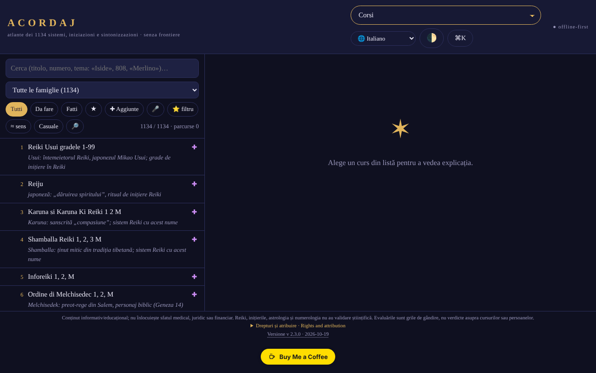

# ACORDAJ

[English](README.md) · [Română](README.ro.md) · [Français](README.fr.md) · **Italiano** · [Español](README.es.md) · [Português](README.pt.md) · [Deutsch](README.de.md) · [Magyar](README.hu.md)

**Versione:** 2.3.9 · **Ultimo aggiornamento:** 2026-10-22

Lingue dell'interfaccia: **Română, English, Français, Italiano, Español, Português (PT), Deutsch, Magyar**

**Applicazione online / demo:** https://chiuta.github.io/ACORDAJ/

ACORDAJ: atlante offline, in un unico file HTML, di 1134 corsi spirituali (accordature, iniziazioni, varianti di Reiki…). Fonti, valutazioni e strumenti di discernimento, in 8 lingue. Senza server, senza tracciamento, trade-free.

Atlante offline dei 1134 corsi spirituali (accordature, iniziazioni, varianti di Reiki e altri), raggruppati in 28 famiglie. Un unico file HTML: lo apri con un doppio clic, senza installazione, senza account, senza internet.

> **Nota:** contenuto informativo/educativo; non sostituisce un parere medico, legale o finanziario. Il Reiki, le iniziazioni, l'astrologia e la numerologia non hanno validazione scientifica; l'app tratta questi argomenti in modo critico, come temi culturali e storici.

## Fonte dei dati
L'elenco dei 1134 titoli (sistemi, iniziazioni, accordature) proviene da cursurispirituale.webnode.ro, mantenuto nell'ordine e nella numerazione di quel sito; il sito elenca solo titoli. Le spiegazioni nell'app sono scritte per famiglie e temi e **non descrivono il contenuto reale dei corsi**. I diritti sull'elenco originale non sono stati verificati.

## Che cosa contiene
- Una scheda per ogni corso: da dove viene, che cosa promette, che cosa si può verificare
- Valutazioni a livello di famiglia (28 famiglie, da 3 a 5 fonti neutrali ciascuna: enciclopedie, NCCIH, Stanford ecc.), redatte nell'atlante e indipendenti dai siti dei venditori; non sono valutazioni di ogni singolo corso, e non tutte le schede individuali hanno fonti proprie
- Laboratorio: strumenti di studio, discernimento critico, creazione e comunità offline
- Analisi SWOT e TOWS per ogni corso e ogni categoria
- Interfaccia in 8 lingue: RO, EN, FR, ES, DE, IT, PT, HU
- Funziona su telefono, tablet e desktop (iOS, Android)

## Principi
- Senza frontiere: un file, senza server, senza account
- Trade-free: senza pubblicità, senza tracciamento, non si vende nulla
- Valuta, non raccomanda

## Limiti
- Le valutazioni sono griglie di riflessione, non sentenze su corsi o persone.
- L'interfaccia **e i contenuti** (schede dei corsi, legende dell'atlante, cronologie, testi di coach/storia, glossario: quasi 477.000 caratteri) sono disponibili nelle 8 lingue; restano invariati solo i nomi propri e i titoli dei corsi della fonte, le note musicali e il blocco bilingue ro+en sui diritti. Le traduzioni dei contenuti sono automatiche, non verificate da madrelingua, e i passaggi su salute, sicurezza e denaro (accordature, cristalli, fuoco/kundalini, chirurgia psichica, «abbondanza» ecc.) **richiedono la revisione di uno specialista**; l'app non fornisce consigli medici o finanziari.
- Le fasi principali della Luna (nuova/piena) sono calcolate con le formule di Meeus (termini principali), con precisione dell'ordine dei minuti (verificate sulla luna nuova del 10.10.2026 alle 15:50 UTC e sulla luna piena del 26.10.2026 alle 04:12 UTC); l'illuminazione della Luna è calcolata dall'elongazione reale Sole–Luna (stesse formule di Meeus, termini principali; scarto dell'ordine di ~1 %), e l'età della Luna è il numero reale di giorni dall'ultima luna nuova.
- Non è un parere medico, legale o finanziario.

## Utilizzo
Scarica `index.html` da Releases e aprilo in un browser.
Verifica l'integrità: `sha256sum index.html`

## Dati e riservatezza
Verificato con audit: la pagina ha una CSP rigorosa (`connect-src 'none'`) e non effettua richieste di rete; le preferenze e le note sono conservate in `localStorage`. Lo script è protetto da una CSP con hash (`script-src 'sha256-…'`, senza `'unsafe-inline'` per gli script); non esistono più gestori inline. Esiste un test di connettività attivato solo dall'utente (il pulsante nella sezione «Senza frontiere»), che dovrebbe essere bloccato dalla CSP.

## Diritti e attribuzione
- **Fonte dell'elenco:** i 1134 titoli provengono da [cursurispirituale.webnode.ro](https://cursurispirituale.webnode.ro/), mantenuti nell'ordine e nella numerazione di quel sito. I titoli appartengono alla fonte e ai loro titolari; i diritti sull'elenco originale non sono stati verificati.
- **Progetto indipendente:** ACORDAJ non è affiliato al sito di origine e non è approvato né sostenuto da esso.
- **Parte dell'autore:** il codice e la struttura dell'app, con licenza MIT (vedi `LICENSE`). La licenza dichiarata si applica SOLO a questa parte. La licenza MIT **non** copre i titoli e i materiali di terzi; i diritti su di essi appartengono ai rispettivi titolari.
- **Rettifica / rimozione:** se sei titolare di diritti o una persona menzionata e desideri una correzione o la rimozione, scrivi a alexio@trom.tf; rispondiamo entro 7 giorni.

*Diritti e attribuzione (EN).* I 1134 titoli dei corsi provengono da [cursurispirituale.webnode.ro](https://cursurispirituale.webnode.ro/), mantenuti nell'ordine e nella numerazione di quel sito; appartengono alla fonte e ai loro titolari. ACORDAJ è un progetto indipendente, non affiliato né approvato da quel sito. La parte dell'autore (codice e struttura) è con licenza MIT; la licenza MIT non copre i titoli né altro materiale di terzi. I titolari di diritti o le persone menzionate che desiderano una correzione o la rimozione: scrivete a alexio@trom.tf; rispondiamo entro 7 giorni.

## Licenza
Licenza MIT per il codice e la struttura dell'app — vedi `LICENSE`. I titoli dei 1134 corsi provengono da cursurispirituale.webnode.ro e non fanno parte di questa licenza (i diritti sull'elenco non sono stati verificati). I testi della pagina sono stati allineati alla licenza MIT nell'audit del giro 2 (in precedenza menzionavano «senza scopo commerciale»).

## Nuove funzioni (v2.2.0)

- **Ricerca per tema in tutto l'atlante** (il pulsante 🔎 accanto a «Casuale», FFF.search): cerca nel titolo, nelle famiglie, nel tipo di pratica, nelle particolarità e nelle note tematiche dei 1134 corsi, tollerante verso diacritici, piccoli errori e forme delle parole, con risultati ordinati e salto diretto alla scheda. In locale, senza IA e senza rete. Non cerca nelle spiegazioni generali della famiglia e non descrive il contenuto reale dei corsi (il sito di origine elenca solo titoli). La ricerca esistente nell'elenco resta invariata.
- **Etichetta di trasparenza e copia .fff.json** (kit comune: core, label, bundle, search): clic su `v 2.2.0 · 2026-10-14` nel piè di pagina; mostra la rete (0 richieste), le chiavi archiviate e consente l'esportazione/importazione (facoltativamente cifrata con password) dei progressi e dei preferiti da `localStorage`. I meccanismi di copia propri in «Dati» restano.
- La somma SHA-256 incorporata (il controllo di integrità nel Laboratorio) è stata ricalcolata; il nuovo codice si trova in uno script separato, gli hash CSP sono stati ricalcolati. `BUILD` = 2.2.0 / 2026-10-14.
- I nuovi testi sono in ro, en, fr, it, es, pt, hu, de; le traduzioni fr/it/es/pt/hu/de sono automatiche e non verificate da madrelingua.
- Test: `tests/fff-r8.test.mjs` (rete bloccata, 1280 e 360 px, axe 0 violazioni con il dialogo aperto, integrità, preferiti nella copia).

## Cronologia / Changelog

- 2.3.9 — 2026-10-22: fff-kit 1.1.4: target touch e dimensione minima del testo
- 2.3.8 — 2026-10-22: fff-kit 1.1.2: PBKDF2 600.000 iterazioni, protezione anti-clickjacking
- **2.3.7 (22 ottobre 2026):** La ricerca semantica (≈ significato) non si blocca più con parole come «constructor»; un solo H1 per pagina; service worker e manifest reali (funziona offline e si può installare via https); alert/confirm/prompt del browser sostituiti da finestre di dialogo proprie, tradotte nelle 8 lingue; le esportazioni CSV antepongono un apostrofo alle celle simili a formule; testo minimo di 12 px; meta description.
- **2.3.6 (22 ottobre 2026):** La scheda di un corso non resta più in rumeno nelle altre lingue: pulsanti (Leggi/Confronta/Salva), «Sul tema», «Rappresentazione grafica», tooltip e tutto il testo dell'interfaccia della scheda sono tradotti nelle 8 lingue (dizionario completo per it/es/pt/hu e stringhe con modelli). Titoli e contenuti dei corsi restano nella lingua originale.
- **2.3.5 (22 ottobre 2026):** Tradotti gli ultimi elementi rimasti in rumeno nelle altre lingue: cinque titoli di termini del glossario, i link «fonte», il messaggio vuoto della vista dei corsi, due aria-label; il titolo della pagina segue ora la lingua dell'interfaccia.

- **2.3.4 (19 ottobre 2026):** i contenuti (schede dei corsi, legende ed etichette SVG dell'atlante, cronologie, testi di coach/storia/aggiunte, glossario, nota sui diritti) sono tradotti in en, fr, es, de, it, pt, hu (100% del testo individuato); l'atlante viene ridisegnato al cambio di lingua. Traduzioni automatiche, non verificate da madrelingua; i passaggi su salute/sicurezza/denaro richiedono la revisione di uno specialista.

- **2.2.0 (14 ottobre 2026):** ricerca per tema (FFF.search), etichetta di trasparenza e copia .fff.json (kit comune), test; somma SHA-256 incorporata ricalcolata.

- **2.1.4 (12 ottobre 2026):** la versione e la data dell'ultimo aggiornamento sono mostrate nell'app (piè di pagina); la somma SHA-256 incorporata e l'hash CSP sono stati ricalcolati.

- **2.1.3 (11 ottobre 2026, rev. 3):** illuminazione della Luna dall'elongazione reale (Meeus, termini principali) invece dell'interpolazione tra le fasi (verificato: ≈0,1 % alla luna nuova del 10.10.2026, ≈99,8 % alla luna piena del 26.10.2026, ≈50 % al primo quarto del 15.04.2024); età della Luna = giorni reali dall'ultima luna nuova; testo nel Calendario dei cicli (che parlava ancora di «calcolo medio-sinodico») corretto; somma di integrità e hash CSP ricalcolati.
- **2.1.2 (11 ottobre 2026, rev. 2):** CSP con hash per lo script, senza `'unsafe-inline'` (l'ultimo gestore inline, il campo del codice di condivisione, è stato sostituito); pulsante «Copia il codice» nella condivisione delle liste; fasi della Luna (nuova/piena) con le formule di Meeus, invece del ciclo medio (errore fino a ~20 h); il tema iniziale segue la preferenza del sistema (chiaro/scuro) quando non ne hai scelto uno, più supporto a `prefers-contrast` e ai colori forzati; contrasto corretto nel tema chiaro; gerarchia di titoli corretta in «Categorie»; le tabelle scorrevoli si possono percorrere con la tastiera. Il menu principale resta un select sotto i 1500 px (17 voci non entrano in una riga); il select è accessibile da tastiera.
- **2.1.1 (11 ottobre 2026):** i dialoghi (finestra di benvenuto ecc.) hanno un nome accessibile (`aria-label` dal titolo), quindi axe-core: 0 violazioni a 1280 e 360 px; il titolo ACORDAJ è ora `<h1>` (la pagina ha sempre un titolo di livello 1).
- Menu principale: su schermi di almeno 1500 px vengono mostrati i pulsanti (non solo il select), per l'accesso diretto da tastiera/automazione; sotto i 1500 px resta il select.
- Il suggerimento «Prima visita?» non compare più sopra la finestra di benvenuto e non copre più l'elenco sul telefono (compare solo dopo la chiusura del benvenuto, 3,5 s). `screenshot.png` rinnovato.
- La somma SHA-256 incorporata è stata ricalcolata dopo le modifiche (il controllo di integrità nel Laboratorio riesce). Versione e data in `BUILD`: 2.1.1 / 2026-10-11. Il file è di ~2,1 MB; irrisolti: le dimensioni e i diritti sull'elenco di origine (decisione dell'autore).

Audit: 2026-10-10; giri 2 e 3: 2026-10-11
