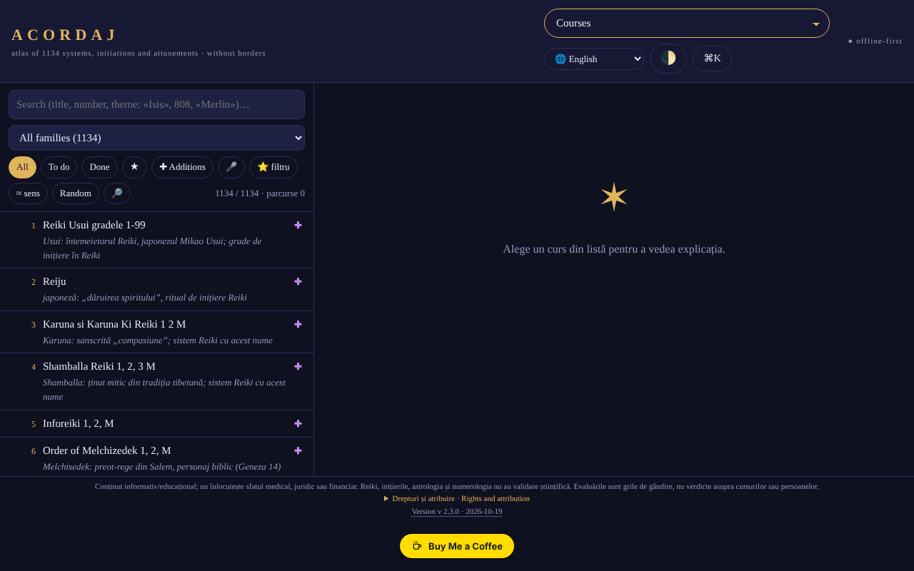

# ACORDAJ

**English** · [Română](README.ro.md) · [Français](README.fr.md) · [Italiano](README.it.md) · [Español](README.es.md) · [Português](README.pt.md) · [Deutsch](README.de.md) · [Magyar](README.hu.md)

**Version:** 2.3.3 · **Last updated:** 2026-10-19

Interface languages: **Română, English, Français, Italiano, Español, Português (PT), Deutsch, Magyar**

**Live app / demo:** https://chiuta.github.io/ACORDAJ/

ACORDAJ: an offline atlas, in a single HTML file, of 1134 spiritual courses (attunements, initiations, Reiki variants…). Sources, assessments and discernment tools, in 8 languages. No server, no tracking, trade-free.

An offline atlas of the 1134 spiritual courses (attunements, initiations, Reiki variants and others), grouped into 28 families. A single HTML file: you open it with a double click, with no installation, no account, no internet.

> **Note:** informational/educational content; it does not replace medical, legal or financial advice. Reiki, initiations, astrology and numerology have no scientific validation; the app treats these subjects critically, as cultural and historical themes.

## Data source
The list of the 1134 titles (systems, initiations, attunements) comes from cursurispirituale.webnode.ro, kept in the order and numbering found there; the site lists titles only. The explanations in the app are written by family and theme and **do not describe the real content of the courses**. The rights over the original list have not been verified.

## What it contains
- A sheet for each course: where it comes from, what is promised, what can be verified
- Family-level assessments (28 families, 3–5 neutral sources each: encyclopedias, NCCIH, Stanford, etc.), written within the atlas and independent of the sellers' websites; they are not assessments of each individual course, and not all individual sheets have their own sources
- Workshop: study tools, critical discernment, creation and offline community
- SWOT and TOWS analyses for each course and each category
- Interface in 8 languages: RO, EN, FR, ES, DE, IT, PT, HU
- Works on phone, tablet and desktop (iOS, Android)

## Principles
- Without borders: one file, no server, no account
- Trade-free: no ads, no tracking, nothing is sold
- It evaluates, it does not recommend

## Limits
- The assessments are frameworks for thinking, not verdicts on courses or persons.
- The translations cover the interface, not the course sheets (which remain in Romanian).
- The main phases of the Moon (new/full) are computed with Meeus's formulas (main terms), accurate to the order of minutes (verified on the new moon of 10.10.2026 15:50 UTC and the full moon of 26.10.2026 04:12 UTC); the Moon's illumination is computed from the real Sun–Moon elongation (the same Meeus formulas, main terms; deviation of the order of ~1%), and the Moon's age is the real number of days since the last new moon.
- It is not medical, legal or financial advice.

## Use
Download `index.html` from Releases and open it in a browser.
Check integrity: `sha256sum index.html`

## Data and privacy
Verified by audit: the page has a strict CSP (`connect-src 'none'`) and makes no network requests; preferences and notes are kept in `localStorage`. The script is protected by a CSP with a hash (`script-src 'sha256-…'`, without `'unsafe-inline'` for scripts); there are no inline handlers any more. There is a connectivity test triggered only by the user (the button in the "Without borders" section), which should be blocked by the CSP.

## Rights and attribution
- **Source of the list:** the 1134 titles come from [cursurispirituale.webnode.ro](https://cursurispirituale.webnode.ro/), kept in the order and numbering found there. The titles belong to the source and their rights holders; the rights over the original list have not been verified.
- **Independent project:** ACORDAJ is not affiliated with the source site and is not approved or endorsed by it.
- **The author's part:** the code and structure of the app, under the MIT licence (see `LICENSE`). The declared licence applies ONLY to this part. The MIT licence does **not** cover the titles and third-party materials; the rights over them belong to their holders.
- **Correction / removal:** if you are a rights holder or a person mentioned and wish for correction or removal, write to alexio@trom.tf; we reply within 7 days.

*Rights and attribution (EN).* The 1134 course titles come from [cursurispirituale.webnode.ro](https://cursurispirituale.webnode.ro/), kept in that site's order and numbering; they belong to the source and their rights holders. ACORDAJ is an independent project, not affiliated with or endorsed by that site. The author's part (code and structure) is under the MIT licence; the MIT licence does not cover the titles or other third-party material. Rights holders or mentioned persons wishing correction or removal: write to alexio@trom.tf; we reply within 7 days.

## License
MIT licence for the code and structure of the app — see `LICENSE`. The titles of the 1134 courses come from cursurispirituale.webnode.ro and are not part of this licence (the rights over the list have not been verified). The texts in the page were aligned with the MIT licence in the round 2 audit (they previously mentioned "non-commercial purposes").

## New features (v2.2.0)

- **Search by theme across the whole atlas** (the 🔎 button next to "Random", FFF.search): searches the title, families, type of practice, particularities and the theme notes of the 1134 courses, tolerant of diacritics, small mistakes and word forms, with ranked results and a direct jump to the sheet. Local, with no AI and no network. It does not search the general explanations of the family and does not describe the real content of the courses (the source site lists titles only). The existing search in the list remains unchanged.
- **Transparency label and .fff.json copy** (shared kit: core, label, bundle, search): click on `v 2.2.0 · 2026-10-14` in the footer; it shows the network (0 requests), the stored keys and allows export/import (optionally encrypted with a password) of the progress and favourites from `localStorage`. The existing backup mechanisms in "Data" remain.
- The embedded SHA-256 sum (the integrity check in the Workshop) was recalculated; the new code sits in a separate script, and the CSP hashes were recalculated. `BUILD` = 2.2.0 / 2026-10-14.
- The new texts are in ro, en, fr, it, es, pt, hu, de; the fr/it/es/pt/hu/de translations are automatic and not verified by native speakers.
- Tests: `tests/fff-r8.test.mjs` (network blocked, 1280 and 360 px, axe 0 violations with the dialog open, integrity, favourites in the copy).

## History / Changelog

- **2.2.0 (14 October 2026):** search by theme (FFF.search), transparency label and .fff.json copy (shared kit), tests; embedded SHA-256 sum recalculated.

- **2.1.4 (12 October 2026):** the version and the date of the last update are displayed in the app (footer); the embedded SHA-256 sum and the CSP hash were recalculated.

- **2.1.3 (11 October 2026, rev. 3):** the Moon's illumination from the real elongation (Meeus, main terms) instead of interpolation between phases (verified: ≈0.1% at the new moon of 10.10.2026, ≈99.8% at the full moon of 26.10.2026, ≈50% at the first quarter of 15.04.2024); Moon age = real days since the last new moon; the text in the Cycles Calendar (which still spoke of "mean-synodic calculation") corrected; the integrity sum and the CSP hash recalculated.
- **2.1.2 (11 October 2026, rev. 2):** CSP with a hash for the script, without `'unsafe-inline'` (the last inline handler, the share-code field, was replaced); "Copy code" button when sharing lists; the Moon's phases (new/full) with Meeus's formulas, instead of the mean cycle (error of up to ~20 h); the initial theme follows the system preference (light/dark) when you have not chosen one, plus `prefers-contrast` support and forced colours; contrast fixed in the light theme; correct heading hierarchy in "Categories"; scrollable tables can be navigated with the keyboard. The main menu remains a select below 1500 px (17 entries do not fit on one row); the select is keyboard-accessible.
- **2.1.1 (11 October 2026):** the dialogs (welcome window, etc.) have an accessible name (`aria-label` from the title), so axe-core: 0 violations at 1280 and 360 px; the ACORDAJ title is now `<h1>` (the page always has a level-1 heading).
- Main menu: on screens of at least 1500 px the buttons are shown (not only the select), for direct access by keyboard/automation; below 1500 px the select remains.
- The "First visit?" hint no longer appears over the welcome window and no longer covers the list on the phone (it appears only after the welcome has been closed, 3.5 s). `screenshot.png` renewed.
- The embedded SHA-256 sum was recalculated after the changes (the integrity check in the Workshop passes). Version and date in `BUILD`: 2.1.1 / 2026-10-11. The file is ~2.1 MB; unresolved: the size and the rights over the source list (the author's decision).

Audit: 2026-10-10; rounds 2 and 3: 2026-10-11
