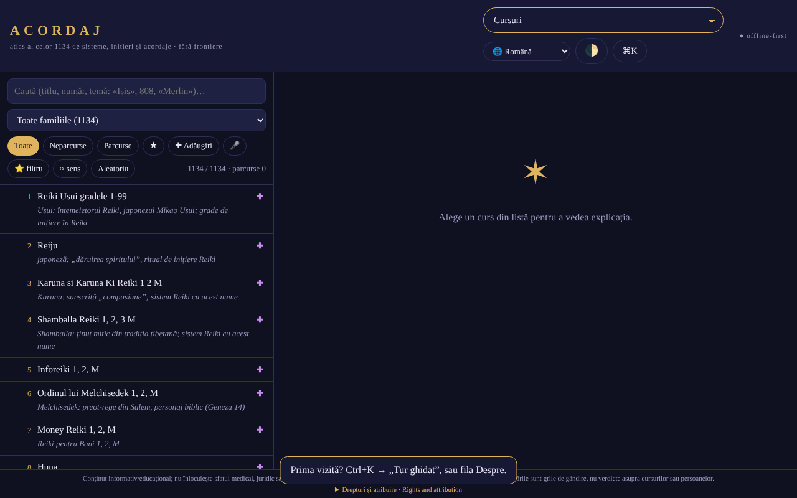

# ACORDAJ

**Live / demo:** https://chiuta.github.io/ACORDAJ/

ACORDAJ: atlas offline, într-un singur fișier HTML, 1134 de cursuri spirituale (acordaje, inițieri, variante Reiki…). Surse, evaluări și unelte de discernământ, în 7 limbi. Fără server, fără urmărire, trade-free.

Atlas offline al celor 1134 de cursuri spirituale (acordaje, inițieri,
variante Reiki și altele), grupate în 28 de familii. Un singur fișier
HTML: îl deschizi cu dublu clic, fără instalare, fără cont, fără internet.

> **Notă:** conținut informativ/educațional; nu înlocuiește sfatul medical, juridic sau financiar. Reiki, inițierile, astrologia și numerologia nu au validare științifică; aplicația tratează aceste subiecte critic, ca teme culturale și istorice.

## Sursa datelor
Lista celor 1134 de titluri (sisteme, inițieri, acordaje) provine de pe cursurispirituale.webnode.ro, păstrată în ordinea și numerotarea de acolo; site-ul listează doar titluri. Explicațiile din aplicație sunt scrise pe familii și teme și **nu descriu conținutul real al cursurilor**. Drepturile asupra listei originale nu au fost verificate.

## Ce conține
- Fișă pentru fiecare curs: de unde vine, ce se promite, ce se poate verifica
- Evaluări la nivel de familie (28 de familii, câte 3–5 surse neutre fiecare: enciclopedii, NCCIH, Stanford etc.), redactate în atlas și independente de site-urile vânzătorilor; nu sunt evaluări ale fiecărui curs în parte, iar nu toate fișele individuale au surse proprii
- Atelier: unelte de studiu, discernământ critic, creație și comunitate offline
- Analize SWOT și TOWS pentru fiecare curs și fiecare categorie
- Interfață în 7 limbi: RO, EN, FR, ES, DE, IT, PT
- Funcționează pe telefon, tabletă și desktop (iOS, Android)

## Principii
- Fără frontiere: un fișier, fără server, fără cont
- Trade-free: fără reclame, fără urmărire, nu se vinde nimic
- Evaluează, nu recomandă

## Limite
- Evaluările sunt grile de gândire, nu sentințe asupra cursurilor sau persoanelor.
- Traducerile acoperă interfața, nu fișele cursurilor (rămân în română).
- Fazele lunii din calendar au o eroare de până la aproximativ o zi.
- Nu este sfat medical, juridic sau financiar.

## Utilizare
Descarcă `index.html` din Releases și deschide-l în browser.
Verifică integritatea: `sha256sum index.html`

## Date și confidențialitate
Verificat prin audit: pagina are CSP strictă (`connect-src 'none'`) și nu face cereri de rețea; preferințele și notele se păstrează în `localStorage`. Există un test de conectivitate declanșat doar de utilizator (butonul din secțiunea „Fără frontiere”), care ar trebui să fie blocat de CSP.

## Drepturi și atribuire
- **Sursa listei:** cele 1134 de titluri provin de pe [cursurispirituale.webnode.ro](https://cursurispirituale.webnode.ro/), păstrate în ordinea și numerotarea de acolo. Titlurile aparțin sursei și titularilor lor; drepturile asupra listei originale nu au fost verificate.
- **Proiect independent:** ACORDAJ nu este afiliat cu site-ul sursă și nu este aprobat sau susținut de acesta.
- **Partea autorului:** codul și structura aplicației, sub CC0 1.0 (vezi `LICENSE`). Licența declarată se aplică DOAR acestei părți. Dedicarea CC0 **nu** acoperă titlurile și materialele terțe; drepturile asupra acestora aparțin titularilor.
- **Rectificare / retragere:** dacă ești titular de drepturi sau persoană menționată și dorești corectarea sau retragerea, scrie la alexio@trom.tf; răspundem în 7 zile.

*Rights and attribution (EN).* The 1134 course titles come from [cursurispirituale.webnode.ro](https://cursurispirituale.webnode.ro/), kept in that site's order and numbering; they belong to the source and their rights holders. ACORDAJ is an independent project, not affiliated with or endorsed by that site. The author's part (code and structure) is CC0 1.0; the CC0 dedication does not cover the titles or other third-party material. Rights holders or mentioned persons wishing correction or removal: write to alexio@trom.tf; we reply within 7 days.

## Licență
CC0 1.0 (domeniu public) pentru codul și structura aplicației — vezi `LICENSE`. Titlurile celor 1134 de cursuri provin de pe cursurispirituale.webnode.ro și nu fac parte din această dedicare (drepturile asupra listei nu au fost verificate). Textele din pagină au fost aliniate la CC0 în audit-ul rundei 2 (anterior menționau „fără scop comercial”).

Audit: 2026-10-10; rundă 2 și 3: 2026-10-11
