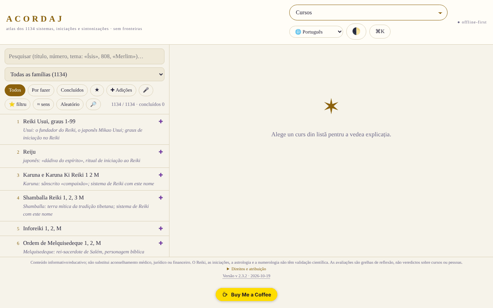

# ACORDAJ

[English](README.md) · [Română](README.ro.md) · [Français](README.fr.md) · [Italiano](README.it.md) · [Español](README.es.md) · **Português** · [Deutsch](README.de.md) · [Magyar](README.hu.md)

**Versão:** 2.3.4 · **Última atualização:** 2026-10-19

Idiomas da interface: **Română, English, Français, Italiano, Español, Português (PT), Deutsch, Magyar**

**Aplicação online / demo:** https://chiuta.github.io/ACORDAJ/

ACORDAJ: atlas offline, num único ficheiro HTML, de 1134 cursos espirituais (afinações, iniciações, variantes de Reiki…). Fontes, avaliações e ferramentas de discernimento, em 8 idiomas. Sem servidor, sem rastreio, trade-free.

Atlas offline dos 1134 cursos espirituais (afinações, iniciações, variantes de Reiki e outros), agrupados em 28 famílias. Um único ficheiro HTML: abre-se com duplo clique, sem instalação, sem conta, sem internet.

> **Nota:** conteúdo informativo/educativo; não substitui o aconselhamento médico, jurídico ou financeiro. O Reiki, as iniciações, a astrologia e a numerologia não têm validação científica; a aplicação trata estes temas de forma crítica, como temas culturais e históricos.

## Fonte dos dados
A lista dos 1134 títulos (sistemas, iniciações, afinações) provém de cursurispirituale.webnode.ro, mantida na ordem e na numeração desse sítio; o sítio apenas lista títulos. As explicações da aplicação são escritas por famílias e temas e **não descrevem o conteúdo real dos cursos**. Os direitos sobre a lista original não foram verificados.

## O que contém
- Uma ficha para cada curso: de onde vem, o que se promete, o que se pode verificar
- Avaliações ao nível das famílias (28 famílias, 3 a 5 fontes neutras cada: enciclopédias, NCCIH, Stanford, etc.), redigidas no atlas e independentes dos sítios dos vendedores; não são avaliações de cada curso individual, e nem todas as fichas individuais têm fontes próprias
- Oficina: ferramentas de estudo, discernimento crítico, criação e comunidade offline
- Análises SWOT e TOWS para cada curso e cada categoria
- Interface em 8 idiomas: RO, EN, FR, ES, DE, IT, PT, HU
- Funciona em telemóvel, tablet e computador (iOS, Android)

## Princípios
- Sem fronteiras: um ficheiro, sem servidor, sem conta
- Trade-free: sem publicidade, sem rastreio, não se vende nada
- Avalia, não recomenda

## Limites
- As avaliações são grelhas de reflexão, não sentenças sobre cursos ou pessoas.
- As traduções abrangem a interface, não as fichas dos cursos (que permanecem em romeno).
- As fases principais da Lua (nova/cheia) são calculadas com as fórmulas de Meeus (termos principais), com precisão da ordem dos minutos (verificadas na lua nova de 10.10.2026 às 15:50 UTC e na lua cheia de 26.10.2026 às 04:12 UTC); a iluminação da Lua é calculada a partir da elongação real Sol–Lua (as mesmas fórmulas de Meeus, termos principais; desvio da ordem de ~1 %), e a idade da Lua é o número real de dias desde a última lua nova.
- Não é aconselhamento médico, jurídico ou financeiro.

## Utilização
Descarregue `index.html` a partir de Releases e abra-o num navegador.
Verifique a integridade: `sha256sum index.html`

## Dados e privacidade
Verificado por auditoria: a página tem uma CSP rigorosa (`connect-src 'none'`) e não faz pedidos de rede; as preferências e as notas são guardadas no `localStorage`. O script está protegido por uma CSP com hash (`script-src 'sha256-…'`, sem `'unsafe-inline'` para scripts); já não existem manipuladores inline. Existe um teste de conectividade acionado apenas pelo utilizador (o botão na secção «Sem fronteiras»), que deverá ser bloqueado pela CSP.

## Direitos e atribuição
- **Fonte da lista:** os 1134 títulos provêm de [cursurispirituale.webnode.ro](https://cursurispirituale.webnode.ro/), mantidos na ordem e na numeração desse sítio. Os títulos pertencem à fonte e aos seus titulares; os direitos sobre a lista original não foram verificados.
- **Projeto independente:** o ACORDAJ não é afiliado ao sítio de origem e não é aprovado nem apoiado por este.
- **Parte do autor:** o código e a estrutura da aplicação, sob licença MIT (ver `LICENSE`). A licença declarada aplica-se APENAS a esta parte. A licença MIT **não** abrange os títulos e os materiais de terceiros; os direitos sobre estes pertencem aos respetivos titulares.
- **Retificação / retirada:** se for titular de direitos ou uma pessoa mencionada e desejar a correção ou a retirada, escreva para alexio@trom.tf; respondemos em 7 dias.

*Direitos e atribuição (EN).* Os 1134 títulos de cursos provêm de [cursurispirituale.webnode.ro](https://cursurispirituale.webnode.ro/), mantidos na ordem e na numeração desse sítio; pertencem à fonte e aos seus titulares de direitos. O ACORDAJ é um projeto independente, não afiliado a esse sítio nem por ele apoiado. A parte do autor (código e estrutura) está sob licença MIT; a licença MIT não abrange os títulos nem outro material de terceiros. Os titulares de direitos ou pessoas mencionadas que pretendam correção ou retirada: escrevam para alexio@trom.tf; respondemos em 7 dias.

## Licença
Licença MIT para o código e a estrutura da aplicação — ver `LICENSE`. Os títulos dos 1134 cursos provêm de cursurispirituale.webnode.ro e não fazem parte desta licença (os direitos sobre a lista não foram verificados). Os textos da página foram alinhados com a licença MIT na auditoria da ronda 2 (anteriormente mencionavam «sem fins comerciais»).

## Novas funcionalidades (v2.2.0)

- **Pesquisa por tema em todo o atlas** (o botão 🔎 junto a «Aleatório», FFF.search): pesquisa no título, nas famílias, no tipo de prática, nas particularidades e nas notas temáticas dos 1134 cursos, tolerante a diacríticos, pequenos erros e formas das palavras, com resultados ordenados e salto direto para a ficha. Local, sem IA e sem rede. Não pesquisa nas explicações gerais da família e não descreve o conteúdo real dos cursos (o sítio de origem lista apenas títulos). A pesquisa existente na lista permanece inalterada.
- **Etiqueta de transparência e cópia .fff.json** (kit comum: core, label, bundle, search): clique em `v 2.2.0 · 2026-10-14` no rodapé; mostra a rede (0 pedidos), as chaves armazenadas e permite a exportação/importação (opcionalmente cifrada com palavra-passe) do progresso e dos favoritos do `localStorage`. Os mecanismos de cópia próprios de «Dados» mantêm-se.
- A soma SHA-256 incorporada (a verificação de integridade da Oficina) foi recalculada; o novo código está num script separado, os hashes CSP foram recalculados. `BUILD` = 2.2.0 / 2026-10-14.
- Os textos novos estão em ro, en, fr, it, es, pt, hu, de; as traduções fr/it/es/pt/hu/de são automáticas e não verificadas por falantes nativos.
- Testes: `tests/fff-r8.test.mjs` (rede bloqueada, 1280 e 360 px, axe 0 violações com o diálogo aberto, integridade, favoritos na cópia).

## Histórico / Changelog

- **2.2.0 (14 de outubro de 2026):** pesquisa por tema (FFF.search), etiqueta de transparência e cópia .fff.json (kit comum), testes; soma SHA-256 incorporada recalculada.

- **2.1.4 (12 de outubro de 2026):** a versão e a data da última atualização são apresentadas na aplicação (rodapé); a soma SHA-256 incorporada e o hash CSP foram recalculados.

- **2.1.3 (11 de outubro de 2026, rev. 3):** iluminação da Lua a partir da elongação real (Meeus, termos principais) em vez da interpolação entre fases (verificado: ≈0,1 % na lua nova de 10.10.2026, ≈99,8 % na lua cheia de 26.10.2026, ≈50 % no quarto crescente de 15.04.2024); idade da Lua = dias reais desde a última lua nova; texto do Calendário de ciclos (que ainda falava de «cálculo médio-sinódico») corrigido; soma de integridade e hash CSP recalculados.
- **2.1.2 (11 de outubro de 2026, rev. 2):** CSP com hash para o script, sem `'unsafe-inline'` (o último manipulador inline, o campo do código de partilha, foi substituído); botão «Copiar o código» na partilha de listas; fases da Lua (nova/cheia) com as fórmulas de Meeus, em vez do ciclo médio (erro até ~20 h); o tema inicial segue a preferência do sistema (claro/escuro) quando não escolheu nenhum, mais suporte para `prefers-contrast` e cores forçadas; contraste corrigido no tema claro; hierarquia de títulos correta em «Categorias»; as tabelas deslizantes podem ser percorridas com o teclado. O menu principal continua a ser um select abaixo de 1500 px (17 entradas não cabem numa linha); o select é acessível por teclado.
- **2.1.1 (11 de outubro de 2026):** os diálogos (janela de boas-vindas, etc.) têm nome acessível (`aria-label` a partir do título), pelo que o axe-core: 0 violações a 1280 e 360 px; o título ACORDAJ é agora `<h1>` (a página tem sempre um título de nível 1).
- Menu principal: em ecrãs de pelo menos 1500 px são apresentados os botões (não apenas o select), para acesso direto por teclado/automação; abaixo de 1500 px mantém-se o select.
- A indicação «Primeira visita?» já não aparece por cima da janela de boas-vindas nem cobre a lista no telemóvel (aparece apenas depois de a boas-vindas ser fechada, 3,5 s). `screenshot.png` renovado.
- A soma SHA-256 incorporada foi recalculada após as alterações (a verificação de integridade da Oficina passa). Versão e data em `BUILD`: 2.1.1 / 2026-10-11. O ficheiro tem ~2,1 MB; por resolver: o tamanho e os direitos sobre a lista de origem (decisão do autor).

Auditoria: 2026-10-10; rondas 2 e 3: 2026-10-11
