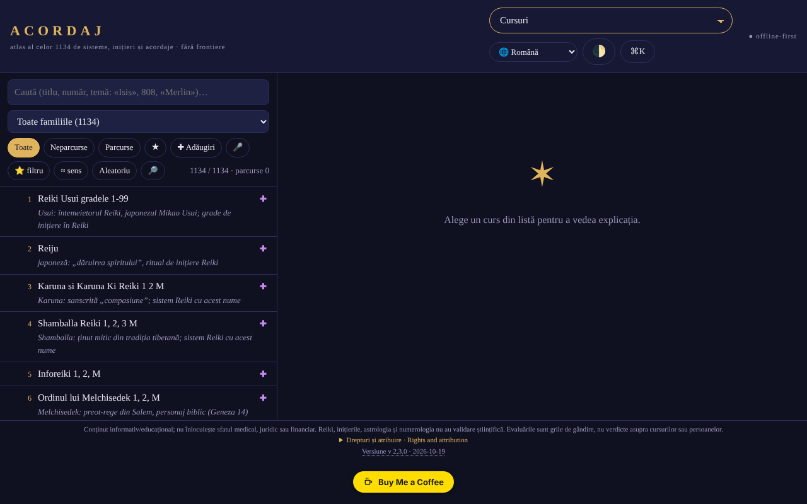

# ACORDAJ

[English](README.md) · **Română** · [Français](README.fr.md) · [Italiano](README.it.md) · [Español](README.es.md) · [Português](README.pt.md) · [Deutsch](README.de.md) · [Magyar](README.hu.md)

**Versiune:** 2.3.9 · **Ultima actualizare:** 2026-10-22

Limbile interfeței: **Română, English, Français, Italiano, Español, Português (PT), Deutsch, Magyar**

**Live / demo:** https://chiuta.github.io/ACORDAJ/

ACORDAJ: atlas offline, într-un singur fișier HTML, 1134 de cursuri spirituale (acordaje, inițieri, variante Reiki…). Surse, evaluări și unelte de discernământ, în 8 limbi. Fără server, fără urmărire, trade-free.

Atlas offline al celor 1134 de cursuri spirituale (acordaje, inițieri,
variante Reiki și altele), grupate în 28 de familii. Un singur fișier
HTML: îl deschizi cu dublu clic, fără instalare, fără cont, fără internet.

> **Notă:** conținut informativ/educațional; nu înlocuiește sfatul medical, juridic sau financiar. Reiki, inițierile, astrologia și numerologia nu au validare științifică; aplicația tratează aceste subiecte critic, ca teme culturale și istorice.

## Sursa datelor
Lista celor 1134 de titluri (sisteme, inițieri, acordaje) provine de pe cursurispirituale.webnode.ro, păstrată în ordinea și numerotarea de acolo; site-ul listează doar titluri. Explicațiile din aplicație sunt scrise pe familii și teme și **nu descriu conținutul real al cursurilor**. Drepturile asupra listei originale nu au fost verificate.

## Ce conține
- Fișă pentru fiecare curs: de unde vine, ce se promite, ce se poate verifica
- Evaluări la nivel de familie (28 de familii, câte 3–5 surse neutre fiecare: enciclopedii, NCCIH, Stanford etc.), redactate în atlas și independente de site-urile vânzătorilor; nu sunt evaluări ale fiecărui curs în parte, iar nu toate fișele individuale au surse proprii
- Atelier: unelte de studiu, discernământ critic, creație și comunitate offline
- Analize SWOT și TOWS pentru fiecare curs și fiecare categorie
- Interfață în 8 limbi: RO, EN, FR, ES, DE, IT, PT, HU
- Funcționează pe telefon, tabletă și desktop (iOS, Android)

## Principii
- Fără frontiere: un fișier, fără server, fără cont
- Trade-free: fără reclame, fără urmărire, nu se vinde nimic
- Evaluează, nu recomandă

## Limite
- Evaluările sunt grile de gândire, nu sentințe asupra cursurilor sau persoanelor.
- Interfața **și conținutul** (fișele cursurilor, legendele atlasului, cronologiile, textele de coach/poveste, glosarul: aproape 477.000 de caractere) sunt disponibile în cele 8 limbi; rămân neschimbate doar numele proprii și titlurile cursurilor din sursă, notele muzicale și blocul bilingv ro+en despre drepturi. Traducerile conținutului sunt automate, neverificate de vorbitori nativi, iar pasajele despre sănătate, siguranță și bani (acordaje, cristale, foc/kundalini, chirurgie psihică, „abundență” etc.) **necesită revizie de specialitate**; aplicația nu oferă sfaturi medicale sau financiare.
- Fazele principale ale Lunii (nouă/plină) sunt calculate cu formulele lui Meeus (termenii principali), cu precizie de ordinul minutelor (verificate pe lună nouă 10.10.2026 15:50 UTC și lună plină 26.10.2026 04:12 UTC); iluminarea Lunii se calculează din elongația reală Soare–Lună (aceleași formule Meeus, termenii principali; abatere de ordinul a ~1 %), iar vârsta Lunii este numărul real de zile de la ultima lună nouă.
- Nu este sfat medical, juridic sau financiar.

## Utilizare
Descarcă `index.html` din Releases și deschide-l în browser.
Verifică integritatea: `sha256sum index.html`

## Date și confidențialitate
Verificat prin audit: pagina are CSP strictă (`connect-src 'none'`) și nu face cereri de rețea; preferințele și notele se păstrează în `localStorage`. Scriptul este protejat prin CSP cu hash (`script-src 'sha256-…'`, fără `'unsafe-inline'` pentru scripturi); nu mai există handlere inline. Există un test de conectivitate declanșat doar de utilizator (butonul din secțiunea „Fără frontiere”), care ar trebui să fie blocat de CSP.

## Drepturi și atribuire
- **Sursa listei:** cele 1134 de titluri provin de pe [cursurispirituale.webnode.ro](https://cursurispirituale.webnode.ro/), păstrate în ordinea și numerotarea de acolo. Titlurile aparțin sursei și titularilor lor; drepturile asupra listei originale nu au fost verificate.
- **Proiect independent:** ACORDAJ nu este afiliat cu site-ul sursă și nu este aprobat sau susținut de acesta.
- **Partea autorului:** codul și structura aplicației, sub licența MIT (vezi `LICENSE`). Licența declarată se aplică DOAR acestei părți. Licența MIT **nu** acoperă titlurile și materialele terțe; drepturile asupra acestora aparțin titularilor.
- **Rectificare / retragere:** dacă ești titular de drepturi sau persoană menționată și dorești corectarea sau retragerea, scrie la alexio@trom.tf; răspundem în 7 zile.

*Rights and attribution (EN).* The 1134 course titles come from [cursurispirituale.webnode.ro](https://cursurispirituale.webnode.ro/), kept in that site's order and numbering; they belong to the source and their rights holders. ACORDAJ is an independent project, not affiliated with or endorsed by that site. The author's part (code and structure) is under the MIT licence; the MIT licence does not cover the titles or other third-party material. Rights holders or mentioned persons wishing correction or removal: write to alexio@trom.tf; we reply within 7 days.

## Licență
Licență MIT pentru codul și structura aplicației — vezi `LICENSE`. Titlurile celor 1134 de cursuri provin de pe cursurispirituale.webnode.ro și nu fac parte din această licență (drepturile asupra listei nu au fost verificate). Textele din pagină au fost aliniate la licența MIT în audit-ul rundei 2 (anterior menționau „fără scop comercial”).

## Funcții noi (v2.2.0)

- **Căutare după temă în tot atlasul** (butonul 🔎 de lângă „Aleatoriu”, FFF.search): caută în titlu, familii, tipul practicii, particularități și notele despre temă ale celor 1134 de cursuri, tolerant la diacritice, greșeli mici și forme ale cuvintelor, cu rezultate ordonate și salt direct la fișă. Local, fără AI și fără rețea. Nu caută în explicațiile generale ale familiei și nu descrie conținutul real al cursurilor (site-ul sursă listează doar titluri). Căutarea existentă din listă rămâne neschimbată.
- **Etichetă de transparență și copie .fff.json** (kit comun: core, label, bundle, search): clic pe `v 2.2.0 · 2026-10-14` din subsol; arată rețeaua (0 cereri), cheile stocate și permite exportul/importul (opțional criptat cu parolă) al progresului și favoritelor din `localStorage`. Mecanismele proprii de copie din „Date” rămân.
- Suma SHA-256 încorporată (verificarea de integritate din Atelier) a fost recalculată; noul cod stă într-un script separat, hash-urile CSP au fost recalculate. `BUILD` = 2.2.0 / 2026-10-14.
- Textele noi sunt în ro, en, fr, it, es, pt, hu, de; traducerile fr/it/es/pt/hu/de sunt automate și neverificate nativ.
- Teste: `tests/fff-r8.test.mjs` (rețea blocată, 1280 și 360 px, axe 0 violări cu dialogul deschis, integritate, favorite în copie).

## Istoric / Changelog

- 2.3.9 — 2026-10-22: fff-kit 1.1.4: ținte tactile și text minim
- 2.3.8 — 2026-10-22: fff-kit 1.1.2: PBKDF2 600 000 iterații, protecție anti-clickjacking
- **2.3.7 (22 octombrie 2026):** Căutarea semantică („≈ sens”) nu mai cade la cuvinte precum „constructor”; un singur H1 în pagină; service worker și manifest reale (funcționează offline și se poate instala prin https); alert/confirm/prompt ale browserului sunt înlocuite cu dialoguri proprii, traduse în cele 8 limbi; exporturile CSV prefixează cu apostrof celulele care seamănă cu formule; text minim 12 px; meta description.
- **2.3.6 (22 octombrie 2026):** Fișa cursului nu mai rămâne în română în celelalte limbi: butoanele (Citește/Compară/Salvează), „Despre temă”, „Reprezentare grafică”, tooltip-urile și tot textul de interfață din fișă sunt traduse în cele 8 limbi (dicționar complet pentru it/es/pt/hu și șiruri cu șabloane). Titlurile și conținutul cursurilor rămân în limba originală.
- **2.3.5 (22 octombrie 2026):** Traduse rămășițele în română din celelalte limbi: cinci titluri de termeni din glosar, linkurile „sursă”, mesajul gol din vizualizarea cursurilor, două aria-label-uri, iar titlul paginii urmează acum limba interfeței.

- **2.3.4 (19 octombrie 2026):** conținutul (fișele cursurilor, legendele și etichetele SVG ale atlasului, cronologiile, textele de coach/poveste/adăugiri, glosarul, nota despre drepturi) este tradus în en, fr, es, de, it, pt, hu (100% din textul identificat); atlasul se redesenează la schimbarea limbii. Traduceri automate, neverificate de vorbitori nativi; pasajele despre sănătate/siguranță/bani necesită revizie de specialitate.

- **2.2.0 (14 octombrie 2026):** căutare după temă (FFF.search), etichetă de transparență și copie .fff.json (kit comun), teste; suma SHA-256 încorporată recalculată.

- **2.1.4 (12 octombrie 2026):** versiunea și data ultimei actualizări sunt afișate în aplicație (subsol); suma SHA-256 încorporată și hash-ul CSP au fost recalculate.

- **2.1.3 (11 octombrie 2026, rev. 3):** iluminarea Lunii din elongația reală (Meeus, termenii principali) în loc de interpolare între faze (verificată: ≈0,1 % la luna nouă din 10.10.2026, ≈99,8 % la luna plină din 26.10.2026, ≈50 % la primul pătrar din 15.04.2024); vârsta Lunii = zile reale de la ultima lună nouă; textul din Calendarul de cicluri (care încă vorbea de „calcul medie-sinodic”) corectat; suma de integritate și hash-ul CSP recalculate.
- **2.1.2 (11 octombrie 2026, rev. 2):** CSP cu hash pentru script, fără `'unsafe-inline'` (ultimul handler inline, câmpul codului de partajare, a fost înlocuit); butonul „Copiază codul” la partajarea listelor; fazele Lunii (nouă/plină) cu formulele lui Meeus, în loc de ciclul mediu (eroare de până la ~20 h); tema inițială urmează preferința sistemului (luminos/întunecat) când nu ai ales una, plus suport `prefers-contrast` și culori forțate; contrast corectat în tema luminoasă; ierarhie de titluri corectă în „Categorii”; tabelele derulabile pot fi parcurse cu tastatura. Meniul principal rămâne select sub 1500 px (17 intrări nu încap pe un rând); selectul este accesibil prin tastatură.
- **2.1.1 (11 octombrie 2026):** dialogurile (fereastra de bun venit etc.) au nume accesibil (`aria-label` din titlu), deci axe-core: 0 violări la 1280 și 360 px; titlul ACORDAJ este acum `<h1>` (pagina are mereu un titlu de nivel 1).
- Meniul principal: pe ecrane de cel puțin 1500 px se afișează butoanele (nu doar selectul), pentru acces direct prin tastatură/automatizare; sub 1500 px rămâne selectul.
- Indicația „Prima vizită?” nu mai apare peste fereastra de bun venit și nu mai acoperă lista pe telefon (apare doar după ce bun-venitul a fost închis, 3,5 s). `screenshot.png` reînnoit.
- Suma SHA-256 încorporată a fost recalculată după modificări (verificarea de integritate din Atelier trece). Versiune și dată în `BUILD`: 2.1.1 / 2026-10-11. Fișierul are ~2,1 MB; nerezolvat: dimensiunea și drepturile asupra listei sursă (decizie a autorului).

Audit: 2026-10-10; rundă 2 și 3: 2026-10-11
